# thymer-plugins

Personal plugins and a theme for [Thymer](https://thymer.com). Each one has its own README with screenshots: click a name.

## Writing and the caret

| | Plugin | What it does |
| --- | --- | --- |
| 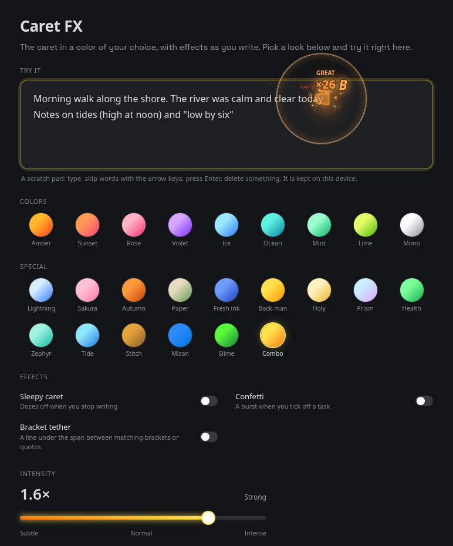 | [Caret FX](plugins/caret-fx) | The caret as a coloured block with glow and smear, presets with their own effects (Lightning, Sakura, Prism, Combo, ...), and a settings page to try them on |
| 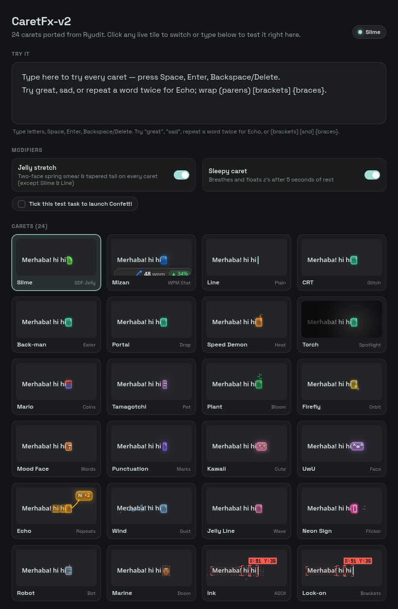 | [CaretFx-v2](plugins/caretfx-v2) | 24 carets ported from Ryudit (Slime, Mizan, CRT, Mario, Ink, Lock-on, ...), with live tiles, a colour tuner on each and modifiers |
| 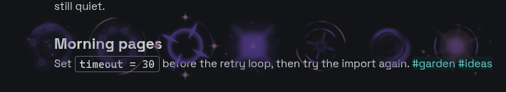 | [Cursor FX](plugins/cursor-fx) | Click effects and pointer trails in five presets (Frost, Arcane, Festival, Sweetheart, Quiet), drawn as WebGL particles |
| 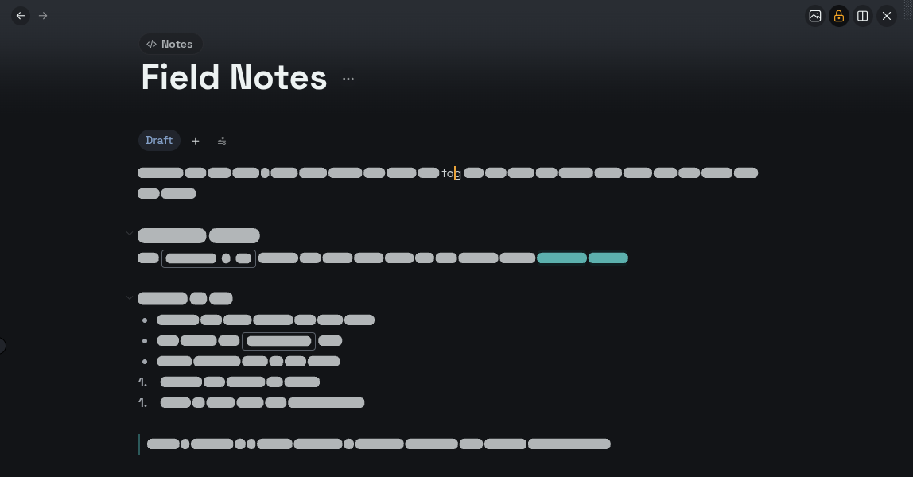 | [DontSpy](plugins/dontspy) | A lock in each panel's title bar that masks its text from onlookers, in nine looks, except around the caret |
| 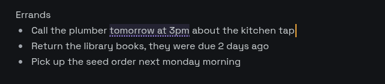 | [Smart Dates](plugins/smart-dates) | Turkish and English date words in a line become Thymer date tags once the caret leaves the line |
| 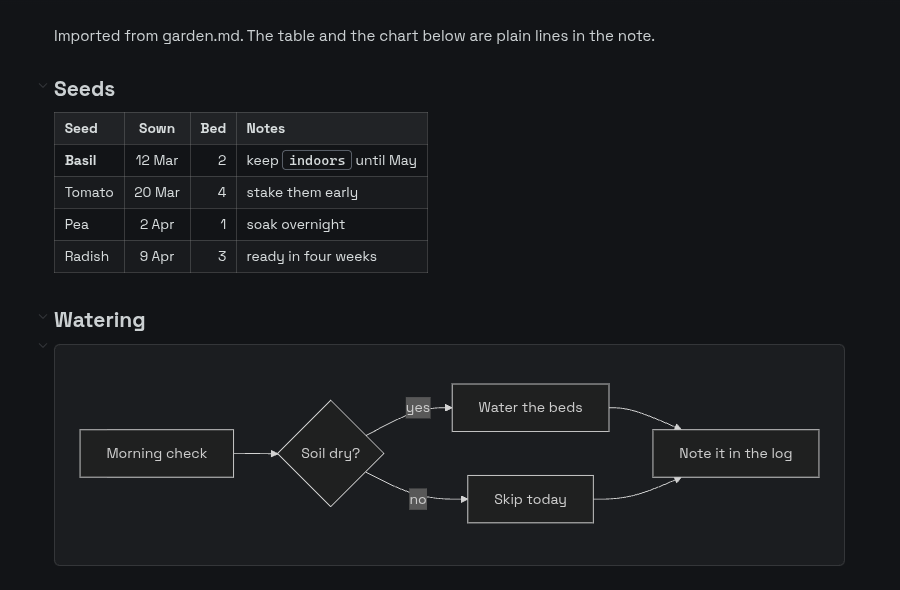 | [Markdown Fix](plugins/markdown-fix) | Draws the pipe tables and mermaid blocks that Thymer's Markdown import leaves as plain text, without editing the notes |
| 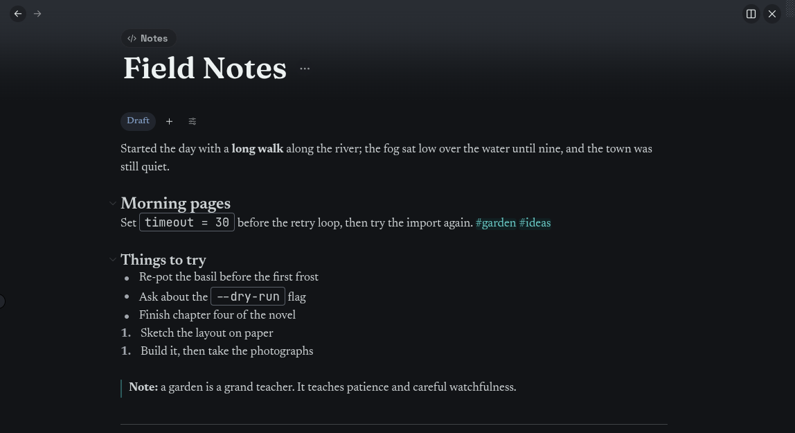 | [Font Loader](plugins/font-loader) | Upload font files or pick system or web fonts for Thymer's interface, editor, headings and code |
| 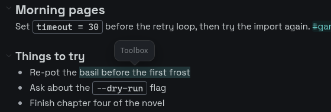 | [toolbox](plugins/toolbox) | A small box with an arrow above selected text; empty for now, tools are added to a `TOOLS` list |

## Pages, dashboards and the sidebar

| | Plugin | What it does |
| --- | --- | --- |
| 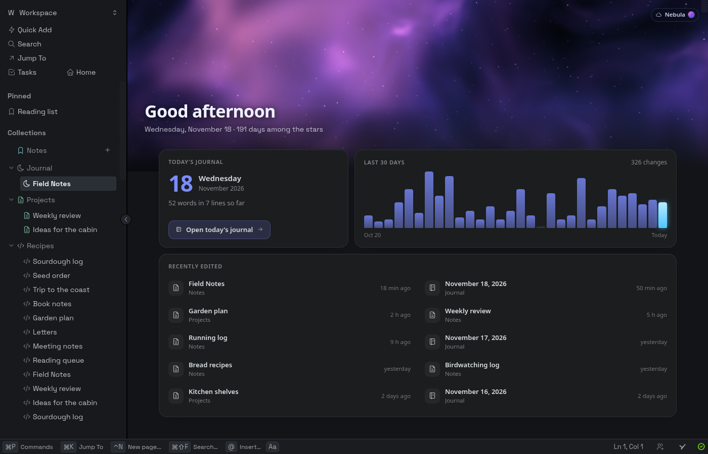 | [Home](plugins/home) | A dashboard beside Tasks: a WebGL sky (nebula, neural field or star atlas, in six biomes), the last 30 days, today's journal and recent pages |
| 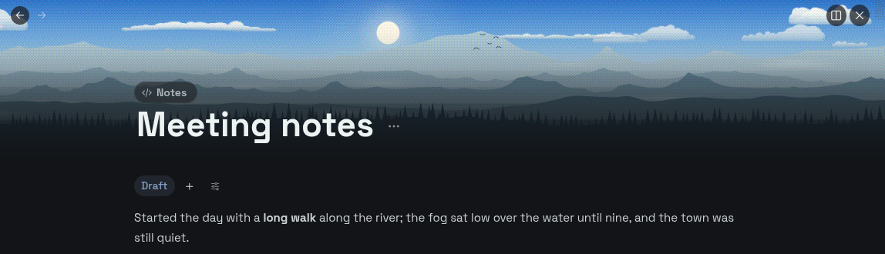 | [Auto Banner](plugins/auto-banner) | Pages without a banner get one of 26 animated scenes, picked by the title, in palettes that follow the time of day; nothing is uploaded |
| 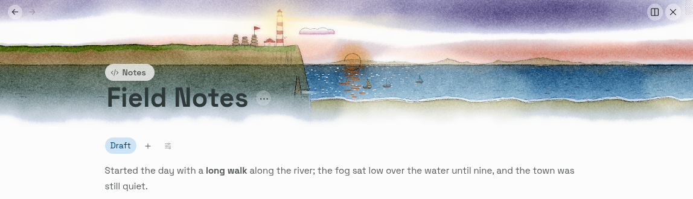 | [Watercolor Banner](plugins/watercolor-banner) | A pencil-and-watercolour landscape at the top of each page, a sketchbook page at the bottom and geometry studies on the start screen, drawn from the page |
| 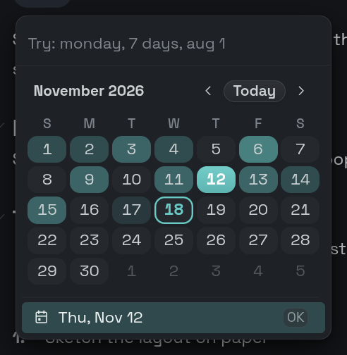 | [Calendar Plus](plugins/calendar-plus) | Thymer's date picker with its days as tiles, tinted by how much changed that day, and a Today button |
| 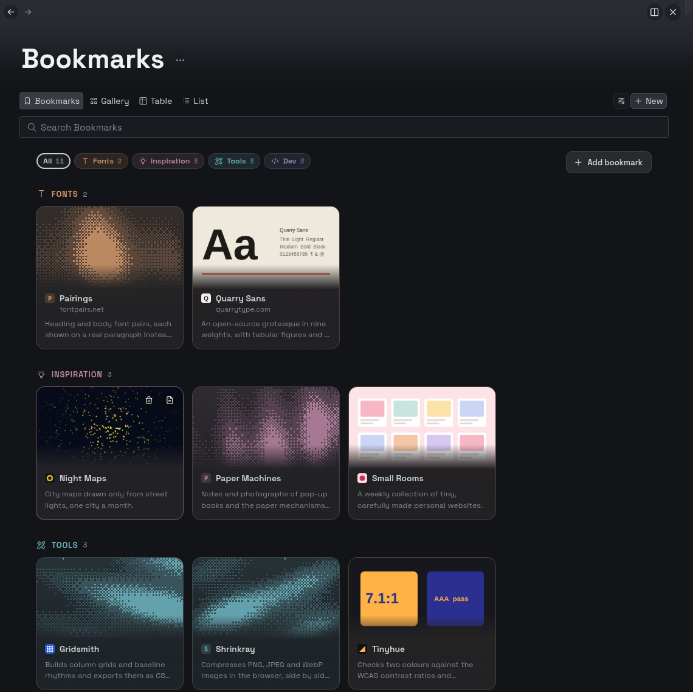 | [Bookmarks](plugins/bookmarks) | A collection for saved sites: cards by category with covers and favicons, category chips and an Add bookmark dialog |
| 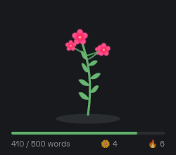 | [Digital Garden](plugins/digital-garden) | A sidebar plant that grows with today's word count, and 12 collectible flowers unlocked by lifetime words |
| 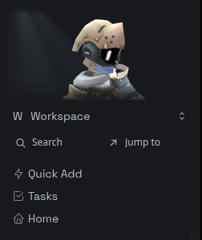 | [Mascot](plugins/achievements) | A small 3D knight at the top of the sidebar that watches the pointer, nods while you type and salutes |
| | [HUD Sounds](plugins/hud-sounds) | Short synthesized sounds for tasks, lines, menus and page changes, panned to where they happen; nothing loaded |
| | [BetterSidebar](plugins/better-sidebar) | The sidebar opens and closes on a curve, and its rows stay in place while it moves instead of vanishing |

## Better UI

Restyles of Thymer's own interface as dark tinted cards, made to go together.

| | Plugin | What it does |
| --- | --- | --- |
| 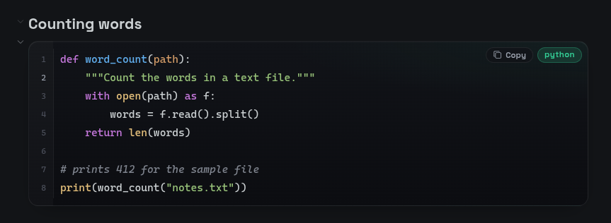 | [BetterCode](plugins/better-code) | Code blocks with line numbers, a language pill and a Copy button; a quieter start screen with a greeting and the date |
| 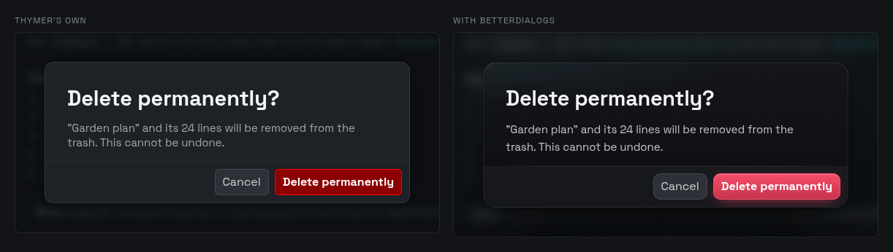 | [BetterDialogs](plugins/better-dialogs) | Dialogs, confirmations and settings as dark tinted cards with a soft entrance and glowing buttons |
| 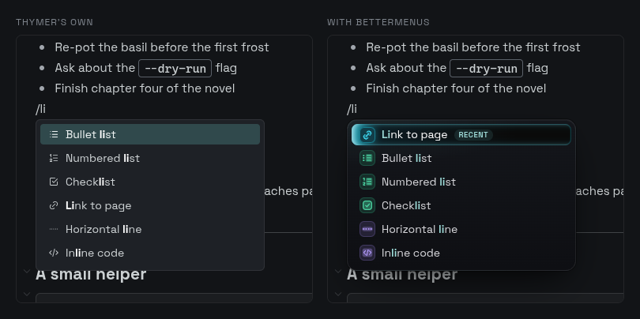 | [BetterMenus](plugins/better-menus) | The / and @ menus, dropdowns and context menus with coloured icon chips; recently used blocks first |
| 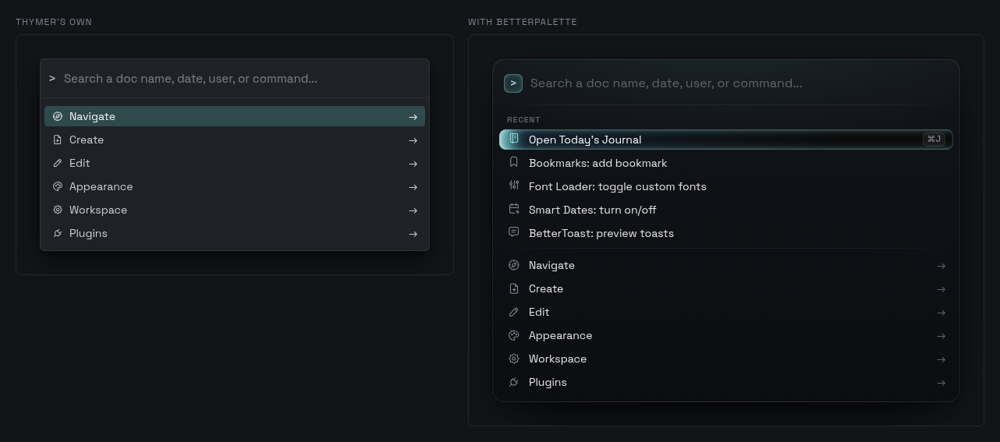 | [BetterPalette](plugins/better-palette) | The command palette restyled, with your recently used commands listed first |
| 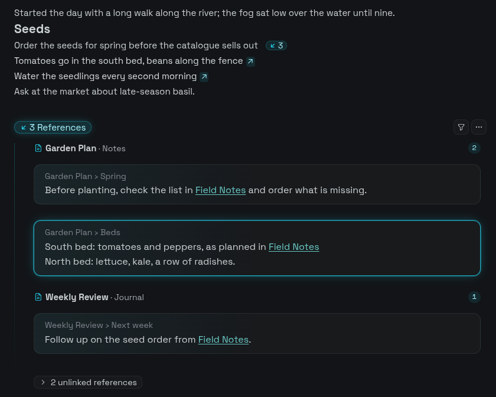 | [BetterRefs](plugins/better-refs) | Line references, backlink counts, the References section and the backlinks popup as tinted cards and chips |
| 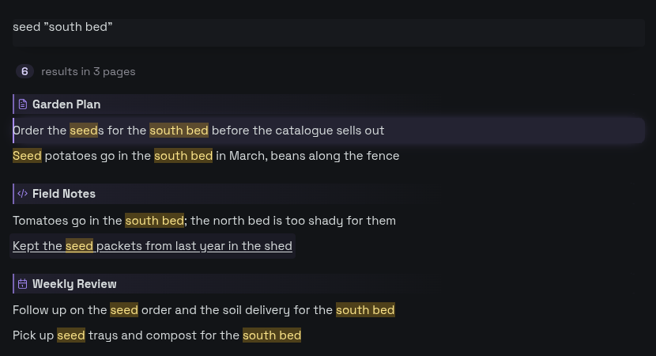 | [BetterSearch](plugins/better-search) | The search panel as tinted cards, with the query's words highlighted in the results |
| 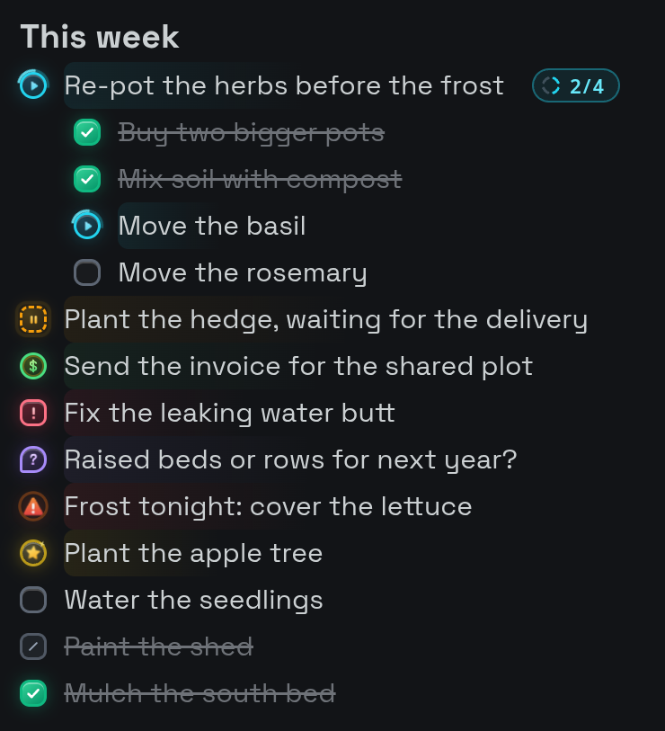 | [BetterTask](plugins/better-task) | Vector task status icons with colours, animations and bursts, subtask progress rings, Alt+click custom statuses and smart task paste |
| 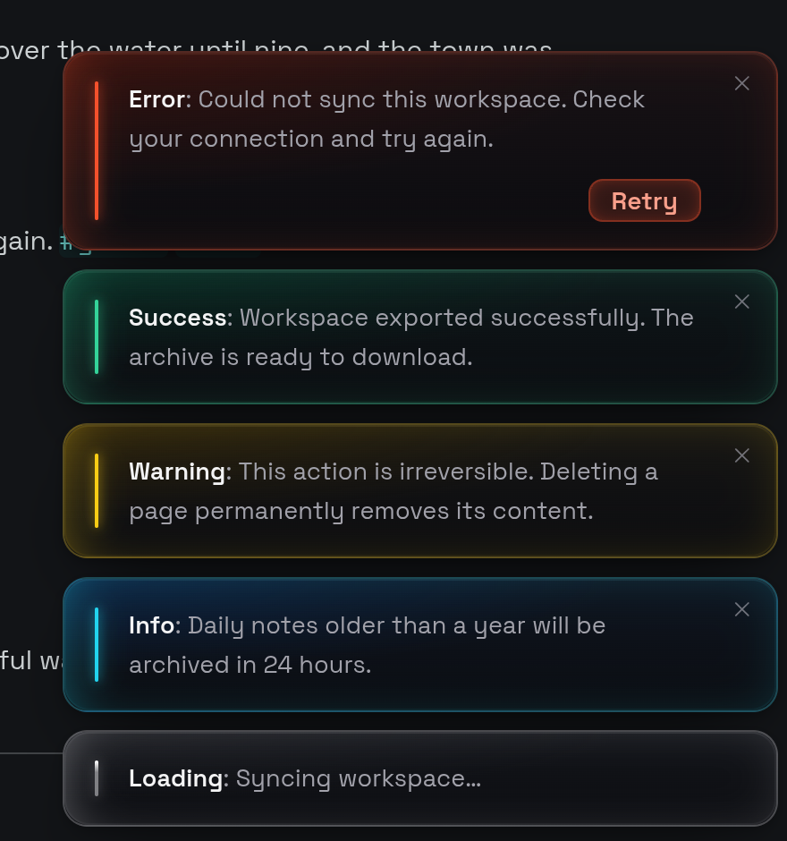 | [BetterToast](plugins/better-toast) | Toasts as dark tinted cards coloured by kind, stacked by their real height, sliding away when dismissed |
| 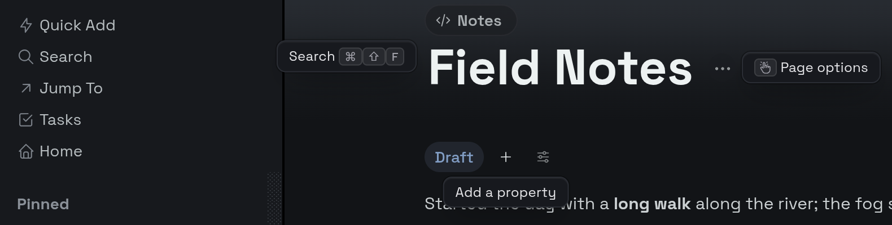 | [BetterTooltip](plugins/better-tooltip) | Tooltips as small rounded pills with keyboard chips and a soft spring-in |
| 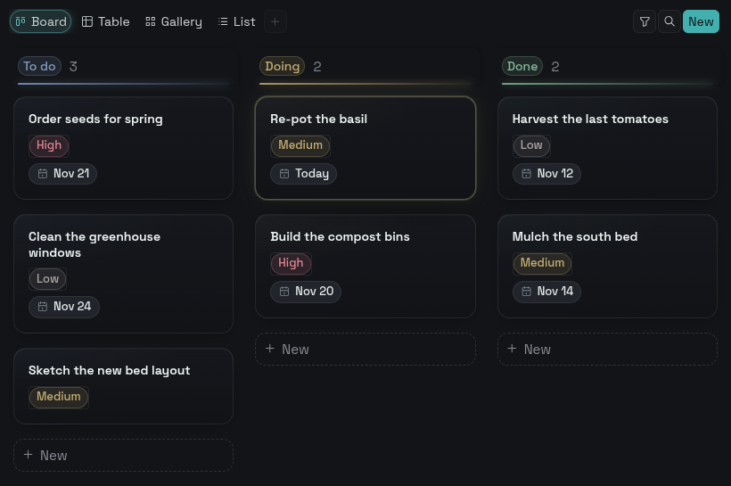 | [BetterViews](plugins/better-views) | Collection boards, tables, gallery and list cards as tinted cards with chip-style property pills |

## Themes

| | Theme | What it is |
| --- | --- | --- |
| 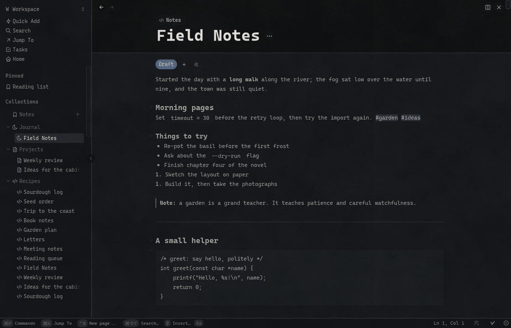 | [Better Dark Paper](themes/better-dark-paper) | Thymer's Dark Paper in charcoal night tones, without its green cast, built from Thymer's own CSS |

## Install a plugin

Most of these are global plugins:

1. In Thymer, create a new **global plugin** (Plugins → New → Global plugin).
2. Open **Edit Code** and paste the contents of the plugin's `plugin.js` into the code tab.
3. Paste the plugin's `plugin.css` into the **CSS** tab.
4. Paste the plugin's `plugin.json` into the **Configuration** tab and save.

Some differ: Bookmarks is a collection plugin, and Mascot and Cursor FX are pasted from a built file. Each plugin's README says how it is installed.

The screenshots were taken outside Thymer, with each plugin's own code and CSS running on a copy of Thymer's page and stylesheet with made-up content.
