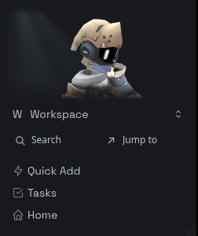
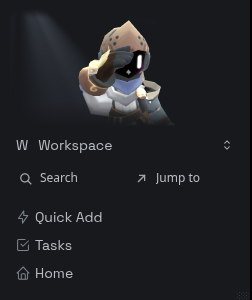

# Mascot

A character card at the top of the sidebar: a small 3D knight that turns its head to the pointer, nods while you type, dozes off when you leave and salutes when you click it, with Thymer's workspace row and Search and Jump to buttons under it. The plugin is called Mascot in Thymer; its folder keeps its old name, `achievements`, from when it also counted 68 writing achievements, now removed.



## What it does

The card is a window onto the knight's head, low-poly and drawn with plain WebGL. The head turns to the pointer on its own while the body stays put, and nods while you type. The knight salutes when Thymer opens and when you click it, the model blending between its idle and salute poses.



The portrait has no frame or background: the canvas fades out at the bottom (a CSS mask), and a few wide, faint god rays (a small fragment shader in the same WebGL context) fan down from the top left behind the knight, drifting slowly and shivering a little. After three minutes without a key or pointer move the knight dozes off (head down), and it wakes at the first one.

Below the portrait sits Thymer's own workspace row. The card's Search and Jump to buttons press Thymer's own Search and Jump To rows, which are hidden while the card is on; the sidebar's content is pushed down to make room for the card.

- In a narrow sidebar only the portrait shows.
- In Thymer's focus mode the card hides.
- On a phone or tablet the plugin stays off.

`Mascot: show or hide` hides or shows the card; the choice is remembered per device. There are no settings.

## Changing the mascot

The knight is made from a [Kozmas](https://www.kozmas.gg) costume by `tools/costume2thymer`, so another costume is one command:

```sh
python3 plugins/achievements/tools/costume2thymer/costume2thymer.py https://www.kozmas.gg/costumes/proto-blade --push
```

It reads the costume's pieces from the page and downloads them (into the git-ignored `tools/costume2thymer/.cache/`), rebuilds the knight's skeleton and poses in headless Blender, writes `knight.json`, builds `achievements.js` and pushes it to Thymer through the desktop app's MCP server (backing up the live plugin first). Without `--push` it stops after writing `knight.json`; `--build` also builds. See `tools/costume2thymer/README.md`.

## Model credits and terms

The knight is the head and shoulders of a costume from **Spiral Knights**, whose assets are copyrighted by **Grey Havens**; Kozmas is an independent fan site for the game. `model/LICENSE.md` has the terms under which the model is used here, and what to do before the repository or the plugin is shared.

## Install

A global plugin: create one (Plugins → New → Global plugin), open **Edit Code**, paste `achievements.js` (the built plugin, model included) into the code tab, `plugin.css` into the **CSS** tab and `plugin.json` into the **Configuration** tab, and save.

`achievements.src.js` is the source. To rebuild after editing it, run `node build.mjs` in this folder (it embeds `knight.json`). With Thymer open and the workspace's MCP access set to readwrite, `python3 tools/costume2thymer/push_thymer.py` writes the build and the CSS into the plugin named Mascot, backing up the live one first.
