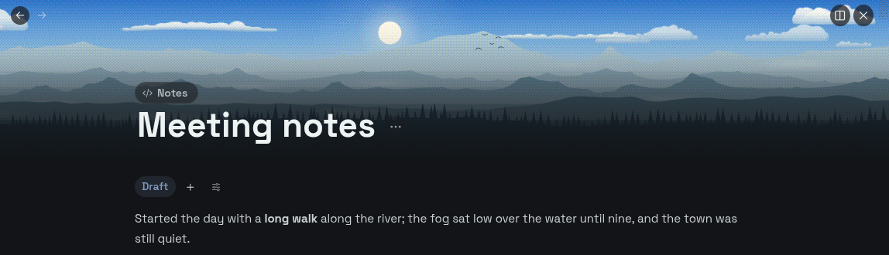
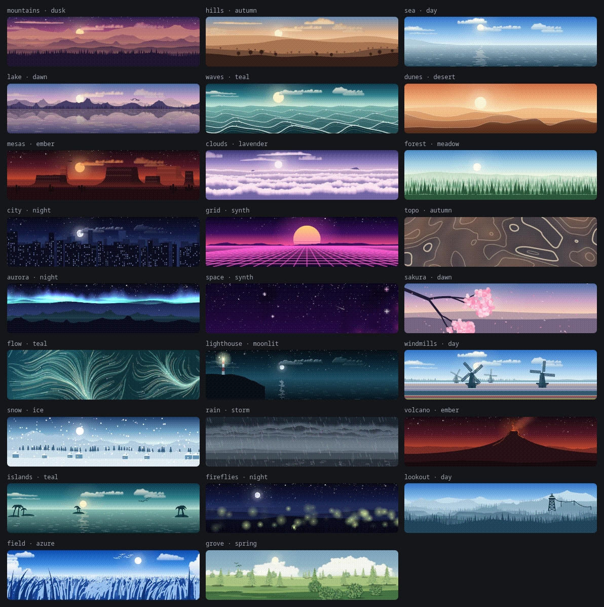
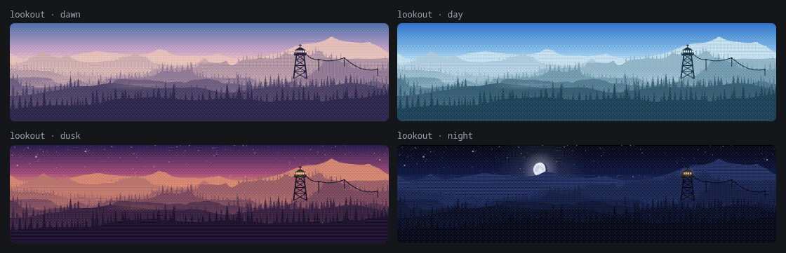

# Auto Banner

A page without a banner of its own gets a picture at the top, in the banner's place, drawn from its title on a canvas while the page is shown. Nothing is generated into the workspace: no image is uploaded and the page is not changed, so turning the plugin off leaves every page as it was, and a page with a banner (its own or its collection's) keeps showing that. The title is the seed: which of the 26 scenes comes is left to chance, but the same title always gives the same one.



## The scenes



Each scene moves a little, in a way that belongs to it:

- mountains (clouds drift, fog drifts between the ridges, birds now and then cross)
- hills
- the sea (the sun shimmers on the water, a sail bobs on)
- a lake (its reflection wavers)
- waves (the rows roll in, the nearer the faster)
- dunes (sand blows off the crests)
- buttes and saguaros (a hawk circles)
- a sea of clouds (its banks drift)
- a forest in fog
- a skyline (windows go on and off, an aeroplane blinks across)
- a synthwave grid (the floor runs towards you)
- a contour map (the sun goes slowly round it)
- an aurora (it folds)
- a nebula (stars twinkle, a shooting star passes)
- cherry blossom (branches sway, petals fall)
- flow lines (sparks run along them)
- a lighthouse (its beams sweep)
- windmills (the lattice sails turn)
- a snowed village (snow falls, chimneys smoke)
- rain (puddles ring, lightning far away)
- a volcano (smoke billows from it, embers are thrown up)
- palm islands (fronds sway)
- fireflies (they wander and blink)

Three are drawn in flat tones with crisp edges:

- a fire lookout among ranges of mountains and firs cut out of paper, each range paler the farther it is, its wires running down to poles (its lamp flickers at night)
- tall grass under towering clouds, like a still from an animated film (gusts run across it and turn its light side up, plumes nod, light flickers on the near grass)
- a grove as pixel art, firs and bushes in clumps of leaves lit on the sun's side over meadows in flat bands (the trees sway)

They were added later and take their share of the pages by a draw of their own, so the other pages keep the scene they had.

The clouds are heaps of round puffs and long thin bands, each puff lit on the side the light comes from, with a dark seam where it meets the next, a flat shaded underside and a bright rim: white by day, warm underneath from a low sun at dawn and dusk, dark with a silver edge by the moon at night, grey in a storm. They turn their lit side to the sun as they pass it and sink into shadow away from it. The sea of clouds is banks of the same puffs, and the rain's sky a low ceiling of them hanging upside down. At night the moon is in tonight's phase, its seas on it and the rest of the disc faint in earthshine. The windmills are smock mills with a gallery, a cap and lattice sails, over polders with poplars, ditches and tulip rows; the volcano's smoke billows in shaded puffs, lit red from below.

## Time of day



The palette follows the time of day (dawn, day, dusk, night): one of the scene's palettes that suits the hour, so a page shows the same scene at noon and at night, in other colours.

## How it looks and moves

- The picture is drawn in a fine ordered dither (Bayer 8x8, a dot to a CSS pixel, ten shades a channel) or smooth with a little grain.
- Sizes go by the strip's height, so a wide panel shows more of the land, not a stretched one.
- The strip takes a banner's height while it shows a picture. The picture follows the title once it has stayed the same for a moment, and follows the panel's width.
- It runs at 10 to 20 frames a second, dithered on the GPU (about a millisecond a frame), and stops while the strip is out of sight, the app is in the background or the system asks for reduced motion.

## Commands

All kept per device:

- `Auto Banner: another picture for this page`: another seed for this page
- `Auto Banner: back to this page's own picture`
- `Auto Banner: switch between dither and smooth`
- `Auto Banner: motion on or off`
- `Auto Banner: follow the time of day or not`
- `Auto Banner: turn on or off`

## Settings

Under `custom` in the Configuration (both optional):

```json
"custom": {
  "exclude": ["Journal"],
  "style": "smooth"
}
```

- `exclude`: collections to skip, by name.
- `style`: the default style, `"dither"` or `"smooth"`. The choice made with the command, kept per device, wins.

## Previews outside Thymer

`preview.html` draws the scenes outside Thymer with `plugin.js` as it is. Serve the `plugins` folder (for example `python3 -m http.server -d plugins`) and open `/auto-banner/preview.html`: every scene or one, in its own palettes or all of them, at a time or playing, with the moon in any phase. `?scene=clouds&palette=dusk&t=12` picks what is shown first.

`styles-preview.html` is a page that compares six candidate art styles, each drawn in code from the same title.

## Install

A global plugin:

1. In Thymer, create a new global plugin (Plugins → New → Global plugin).
2. Open **Edit Code** and paste `plugin.js` into the code tab.
3. Paste `plugin.css` into the **CSS** tab.
4. Paste `plugin.json` into the **Configuration** tab and save.
