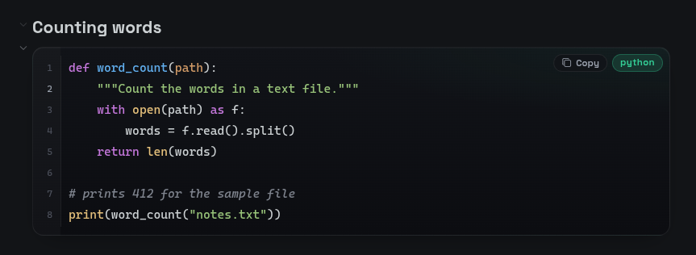
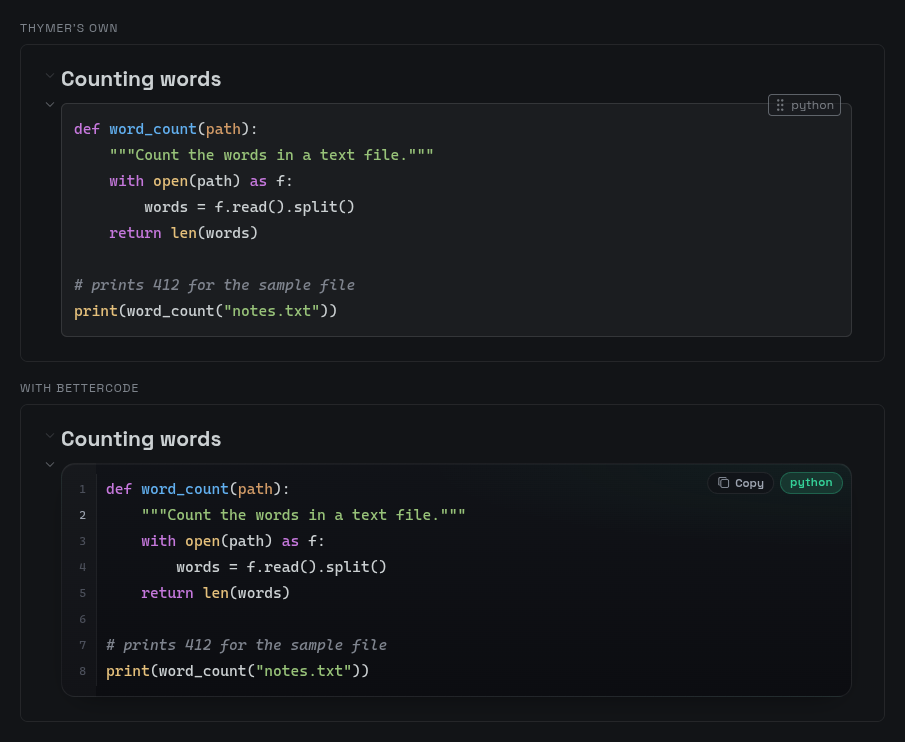
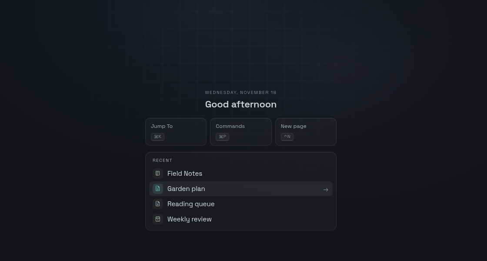

# BetterCode

Draws Thymer's code blocks as dark tinted cards with line numbers in a left gutter, the block's language as a small pill that is always visible, and a Copy button that appears while the pointer is over a block. It also gives the empty panel (no page open) a quieter start screen: a greeting with today's date, the shortcuts as small cards and the recent pages in one card, over a fine grid and two slowly drifting lights.

## What it changes

### Code blocks

- **The card**: rounded corners, a thin border, a dark gradient with a faint green light in the top right corner, and a soft shadow.
- **Line numbers** sit in a gutter on the left, divided from the code by a thin line. The number of the line under the pointer, or of the line with the caret, is brighter. The numbers are drawn by CSS and are not part of the text, so they are not selected or copied.
- **The language pill** sits inside the block's top right corner and is always visible (Thymer shows its language button only on hover, with drag-grip dots). It is lowercase, in the accent green. Clicking it still opens the block's menu.
- **Copy**: while the pointer is over a code block, a Copy button appears to the left of the language pill. It copies the block's lines joined by newlines and reads "Copied" for a moment. The first line of the block leaves room on its right for the pill and the button. The button is not shown for folded blocks, on mobile, or once the block's top has scrolled under the panel's top.

### Start screen

When a panel has no page open (desktop only):

- a fine grid fades out around the middle of the panel, under two soft lights, blue and violet, that drift slowly back and forth;
- Thymer's logo is smaller and quieter;
- above the shortcuts, today's date and a greeting for the time of day: Good morning (5 to 12), Good afternoon (12 to 18), Good evening (18 to 22), Good night (otherwise). When the language Thymer reports (`navigator.language`) is Turkish, both are in Turkish. They are refreshed every minute;
- the three shortcuts sit side by side as small cards, the name above its keys;
- the recent pages are in one card, each with its icon in a chip; the row under the pointer gets an arrow on its right;
- the logo and the rest fade in when the screen opens.

There are light and dark variants; the plugin picks one from the current theme and switches when the theme changes. With reduced motion turned on in the system, the lights do not drift and nothing fades in. There are no commands or settings.

## How it works

Almost all of it is CSS on Thymer's own elements. A code block is `.block-container-div.block-codelang`, and each of its lines is its own row inside the block; the line numbers are a CSS counter drawn in each row's `::after`. The Copy button is a single button added to the page's body and laid over the block under the pointer, so nothing is inserted into the block. The greeting and date are the only element added to Thymer's start screen; the grid and the lights are pseudo-elements under its content, kept inside the panel's edges so the start screen does not scroll.

## Install

A global plugin: create one (Plugins → New → Global plugin), open **Edit Code**, paste `plugin.js` into the code tab, `plugin.css` into the **CSS** tab and `plugin.json` into the **Configuration** tab, and save.
