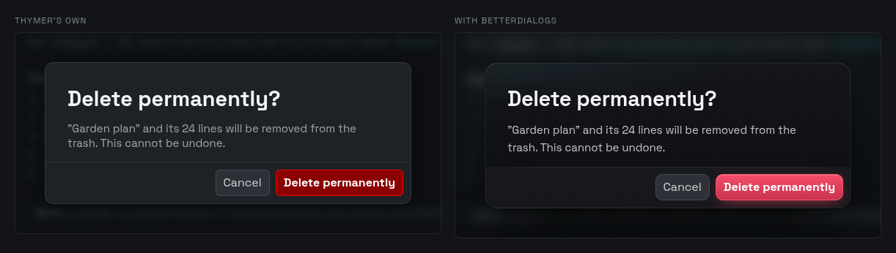
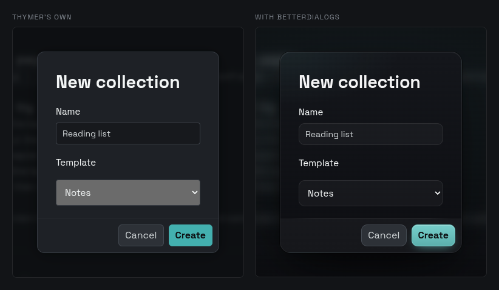
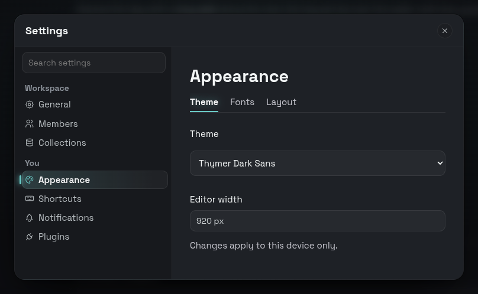

# BetterDialogs

Draws Thymer's dialogs, confirmations and the settings dialog in one dark tinted style: rounded cards over a blurred backdrop, a soft entrance, glowing primary and danger buttons, rounded fields, and a settings menu with a glowing line beside the open section. Thymer still sizes and lays out every dialog; only colours, corners, shadows and the entrance change.

## What it changes

- **Backdrop**: a stronger blur with a faint glow of the theme's accent colour in the middle (opaque backdrops are left alone).
- **The card**: rounded corners, a thin border, a dark gradient lit faintly from the top left in the accent colour, and a deeper shadow. Popout dialogs keep Thymer's look.
- **Entrance**: the dialog rises a little and grows from slightly smaller with a soft spring, instead of Thymer's quick scale. With reduced motion turned on in the system it only fades in.
- **Text**: titles are brighter and a little heavier; body text has more line height.
- **Bottom bar**: no hard border line, a soft tint and a divider that fades out at both ends.
- **Buttons**: large buttons have rounder corners. Primary buttons are an accent gradient with a soft glow, brighter on hover, and press in slightly when clicked. Danger buttons (permanent delete and the like) are a red gradient with a red glow instead of Thymer's dark red block; this applies to danger buttons everywhere, not only in dialogs.
- **Fields**: text fields, selects and text areas are rounded with a soft fill and get an accent ring while focused; switches use the accent colour.
- **Tabs**: the selected tab's underline is the accent colour, with a soft glow on its label.
- **Settings**: a thin, faint divider beside the menu, rounded menu items, the open section tinted with the accent and marked by a glowing accent line on its left edge (its icon in the accent too), a rounded search field, and round close and back buttons.

The accent is the theme's primary colour. There are light and dark variants; the plugin picks one from the current theme and switches when the theme changes. There are no commands or settings.

## How it works

`plugin.css` does the drawing, on Thymer's own modal classes. `plugin.js` only adds a class to the page's body that switches the look on, and a second class for light themes.

## Install

A global plugin: create one (Plugins → New → Global plugin), open **Edit Code**, paste `plugin.js` into the code tab, `plugin.css` into the **CSS** tab and `plugin.json` into the **Configuration** tab, and save.
