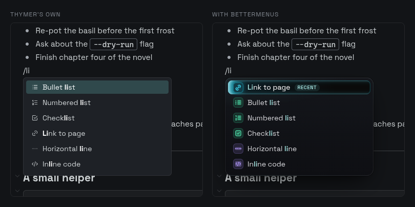
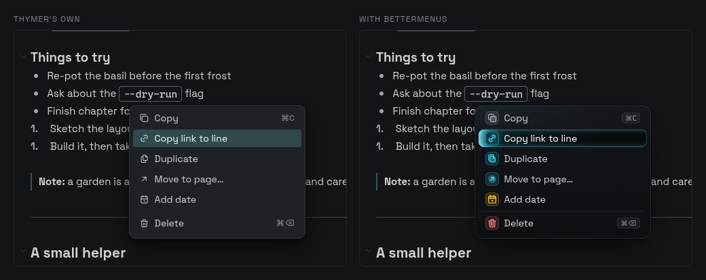

# BetterMenus

Draws Thymer's inline menus (the `/` and `@` menus, dropdowns and context menus) as dark tinted cards with a glowing selected row and coloured icon chips, and puts the blocks you used last first when you search the editor's `/` menu. It is the same family of look as BetterPalette. Desktop only; on mobile Thymer's menus are left as they are.



## What it changes

### The look

- **The card**: rounded corners, a thin border, a dark gradient lit faintly from the top left in the theme's accent colour, a deeper shadow and a softer entrance. A menu's filter field, when it has one, sits over a divider that fades out at both ends.
- **Rows** are rounded and tint on hover. The selected row is lit from its left edge in the colour of its icon (the accent colour for icons without one).
- **Icons** sit in small chips tinted with their colour. About fifty common ones (text and headings, lists and tasks, blocks you insert, pages and links, dates and people, task flags, copy and delete, ...) are drawn as two-tone icons, coloured by kind: blue for text and formatting, green for lists and tasks, violet for blocks, cyan for pages and navigation, amber for dates and people, red for delete and alerts. Other icons keep Tabler's glyph in the same chip.
- **Details**: the matched letters are in the accent colour, keyboard shortcuts are small chips, category headings are small uppercase labels.

Thymer sizes these menus itself (it reads the top padding and uses a fixed row height), so no row height, bottom padding or width is changed.



### Recently used blocks first

When you search in the editor's `/` menu, the entries you picked there recently that match what you typed (as a substring, or by the starts of their words) move to the very top, above matching categories, with a small **Recent** tag. An entry is remembered when you pick it in that menu with Enter or a click; the last 12 are kept, on this device. The empty `/` menu's Suggestions are Thymer's own and are left as they are. Other inline menus (`@`, dropdowns, context menus) are only restyled.

Command: `BetterMenus: clear recently used blocks` forgets the list.

There are light and dark variants; the plugin picks one from the current theme and switches when the theme changes. There are no settings.

## How it works

Thymer ranks menu entries with `window.fuzzysort`, so `fuzzysort.go` is wrapped: while the editor's menu is open (entries in its "format" and "insert" categories), recently used entries that match the query are given scores above any real match, so Thymer's own sort keeps them first, and get the `bme-recent` class that draws the tag. Picks are read in the capture phase, before Thymer acts on them, and kept in `localStorage`. Nothing is inserted into Thymer's elements.

The two-tone icons are generated: `icons.py` holds each icon as two 24×24 masks (a soft back layer and a crisp front layer) and a colour, and writes them into `plugin.css` between the `ICONS:BEGIN` and `ICONS:END` markers. After editing it, run:

```sh
python3 plugins/better-menus/icons.py
```

## Install

A global plugin: create one (Plugins → New → Global plugin), open **Edit Code**, paste `plugin.js` into the code tab, `plugin.css` into the **CSS** tab and `plugin.json` into the **Configuration** tab, and save. `icons.py` is only needed to rebuild the icons; it is not pasted into Thymer.
