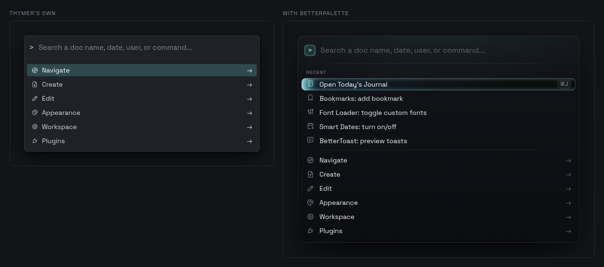
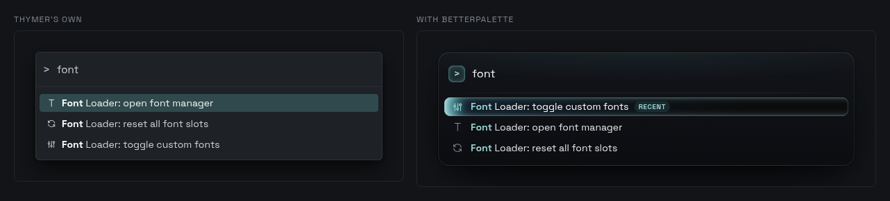

# BetterPalette

Puts the commands you ran last at the top of Thymer's command palette, and draws the palette as a dark tinted card with a glowing selected row. With the palette in command mode (`>`) and nothing typed, a **Recent** list of your last commands sits above Thymer's own list; while you type, recently used commands that match come first. Desktop only; on mobile Thymer's palette sheet is left as it is.

## What it does

### Recent commands

- **Nothing typed**: in command mode, a Recent list of the last 5 commands you ran (with their icons and shortcuts) is shown above Thymer's results, and its first row is selected. Arrow keys move through it and on into Thymer's list (Arrow Up from Thymer's top row comes back into it); Enter or a click runs the command. The list is not shown inside a category.
- **While typing**: recently used commands that match what you typed (as a substring, or by the starts of their words) move to the very top, above matching categories, with a small **Recent** tag.
- A command is remembered when you pick it in command mode with Enter or a click: its label, icon and shortcut, the last 8 of them, on this device. Pages, searches and "create a page" entries are not remembered.

Running a command from the Recent list types its label into the palette and clicks Thymer's own result for it, so Thymer runs the command the usual way. If the command no longer exists, its search is left in view.

Command: `BetterPalette: clear recent commands` forgets the list.

### The look

- **The card**: 600 pixels wide, its top at 13% of the window's height (at least 72 pixels down), with rounded corners, a thin border, a dark gradient lit from the top in the theme's accent colour, and a deeper shadow.
- **The input** is larger, over a divider that fades out at both ends; the mode sign (`>`, `@`, ...) is an accent chip.
- **Rows** are rounded and tint on hover; the selected row is lit from its left edge in the accent colour, its icon glowing. Matched letters are in the accent colour, keyboard shortcuts are small chips, headings are small uppercase labels. The rows of the Recent list slide in one after another (not with reduced motion turned on in the system).

Thymer's result rows keep their fixed height. There are light and dark variants; the plugin picks one from the current theme and switches when the theme changes. There are no settings.

## How it works

Thymer builds and ranks the palette's results inside its own code, out of the SDK's reach, so there are two hooks:

- **Searching**: Thymer ranks with `window.fuzzysort`, so `fuzzysort.go` is wrapped. In command mode, recently used commands that match the query are given scores above any real match, so Thymer's own sort keeps them first, and get the `bpal-recent` class that draws the tag.
- **Nothing typed**: Thymer lists only categories there, so the Recent list is drawn as a sibling of Thymer's result container inside the dialog. Its arrow keys and Enter are handled in the capture phase, before Thymer's own keydown handler.

Nothing is inserted into Thymer's rows. The recent commands are kept in `localStorage`.

## Install

A global plugin: create one (Plugins → New → Global plugin), open **Edit Code**, paste `plugin.js` into the code tab, `plugin.css` into the **CSS** tab and `plugin.json` into the **Configuration** tab, and save.
