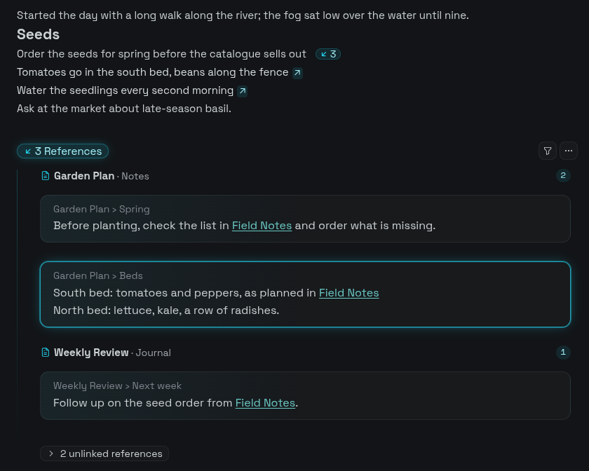
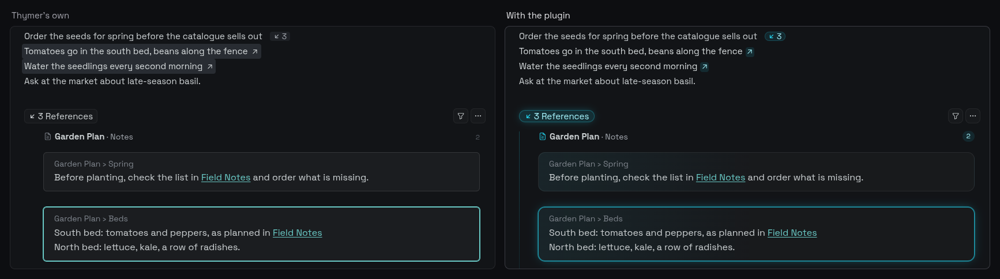
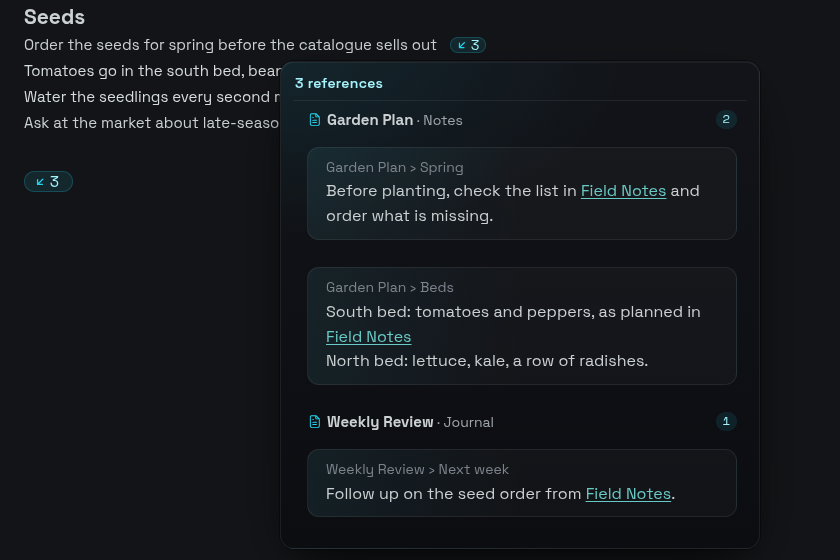

# BetterRefs

Restyles Thymer's line references and backlinks in a cyan accent: the backlink count on a line becomes a small chip, the References section under a page shows its context as tinted cards, and the popup that opens from a backlink count gets the same cards. Thymer still builds every element; the plugin only changes colours, borders, radii and shadows, so line heights and spacing in the editor stay as they are.

## What it changes

- **Referenced lines** (a line shown in a page but owned by another) lose their box and underline, since a page can be a whole list of them; the line tints only while the pointer is on it. The small ↗ button at the end of the line is tinted instead.
- **Lines whose source was deleted** are muted and struck through rather than red.
- **The backlink count** on a line is a rounded cyan chip that glows on hover.
- **The References section** under a page: its toggle is a pill that glows while the section is open, the spine on its left fades from cyan, each source page has a cyan icon and its count as a chip, and each context card is a rounded card tinted from the left. Hovering a card tints its edge; the selected card glows. Matches in the unlinked references are highlighted in cyan.
- **The backlinks popup** (click a backlink count) is a rounded card with a cyan glow in its top corner, a deeper shadow, a short pop-in, and its title set off by a line.

There are light and dark variants; the plugin picks one from the current theme and switches when the theme changes. With reduced motion turned on in the system, the popup does not animate.

There are no commands or settings.

## Install

A global plugin: create one (Plugins → New → Global plugin), open **Edit Code**, paste `plugin.js` into the code tab, `plugin.css` into the **CSS** tab and `plugin.json` into the **Configuration** tab, and save. All the drawing is in `plugin.css`; `plugin.js` only switches the look on and picks the light or dark variant.
