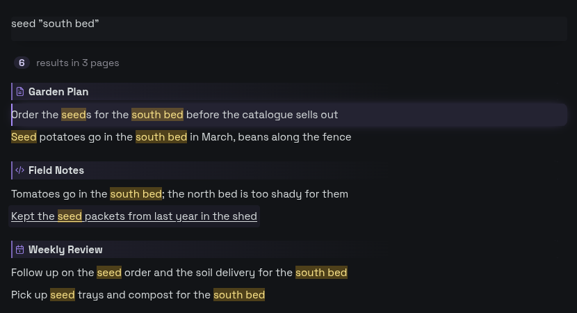
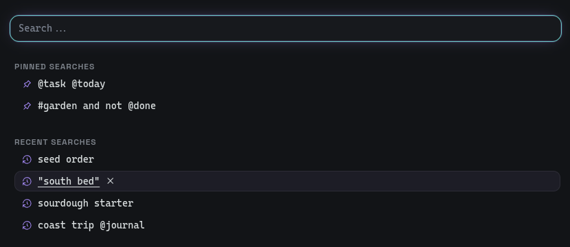
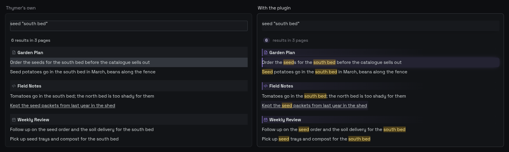

# BetterSearch

Restyles Thymer's search panel with a violet accent and marks the words of your query in the results. The query field, the result count, the recent and pinned searches, the result groups and the selected result are drawn as tinted cards; Thymer's own search, ranking and query syntax are unchanged.

## What it changes

- **Matched words** in the results are marked in amber. The words come from the query as you typed it, leaving out Thymer's query syntax (`@filters`, `field:value`, `and` / `or` / `not`, brackets); text in quotes counts as one phrase, so `"south bed"` marks the phrase and not each word. Words shorter than two letters are skipped.
- **The query field** is a rounded card that glows violet while it has focus.
- **The result count** is a small violet chip.
- **Recent and pinned searches** (Thymer's own lists; the plugin does not change what is in them) get small uppercase headings, monospaced entries and a rounded, tinted row on hover; the history and pin icons are violet.
- **Result groups**: each page's heading sits on a tinted strip with a violet edge. A result row tints on hover, and the selected result has a violet edge and a soft glow.

There are light and dark variants; the plugin picks one from the current theme and switches when the theme changes. There are no commands or settings.

## How it works

The marks use the CSS Custom Highlight API: ranges over the text of the result rows are registered as the `bse-match` highlight, and `plugin.css` paints `::highlight(bse-match)`. Nothing is inserted into Thymer's elements, which Thymer rebuilds on every query. Open search panels are found with a light poll; each one gets a MutationObserver, and the marks are rebuilt on the next frame after its results or query change. Result rows keep Thymer's sizes; only colours, borders and shadows change on them.

## Install

A global plugin: create one (Plugins → New → Global plugin), open **Edit Code**, paste `plugin.js` into the code tab, `plugin.css` into the **CSS** tab and `plugin.json` into the **Configuration** tab, and save.
