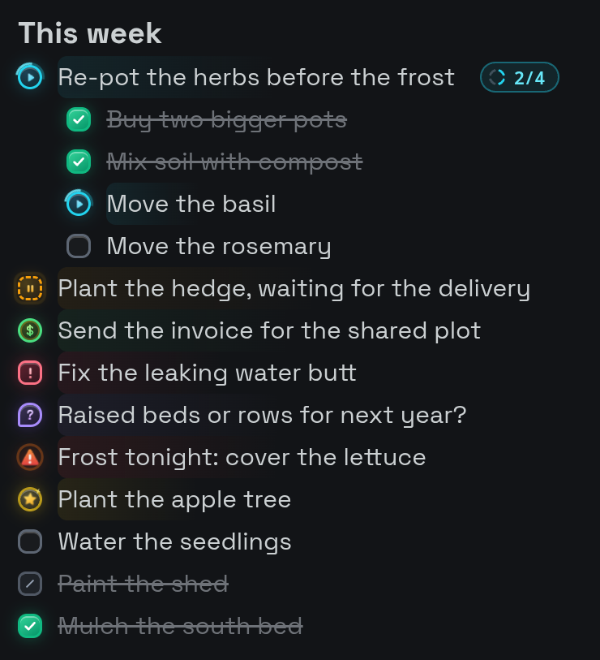
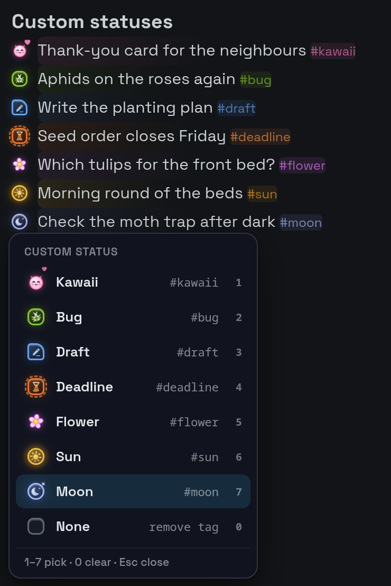
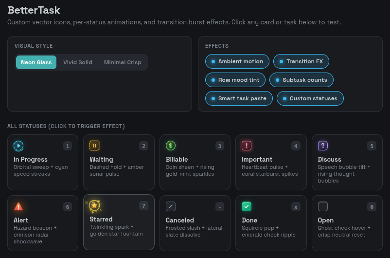

# BetterTask

Draws Thymer's task checkboxes as hand-made vector icons, one colour and silhouette per status, with small looping animations and a burst of particles when a task changes status. It adds a progress badge to tasks with subtasks, seven extra statuses kept as hashtags (picked with Alt+click on a checkbox), and turns pasted Markdown task lists into tasks.



## Statuses

Every one of Thymer's statuses gets its own icon, colour and ambient motion, and its own transition burst (drawn on a canvas over the window) when a task switches to it:

| Status | Look | Burst |
| --- | --- | --- |
| In Progress | cyan play ring | orbital sweep and cyan speed streaks |
| Waiting | amber dashed pause pill | dashed hold and amber sonar pulse |
| Billable | mint-gold coin | coin sheen and rising gold-mint sparkles |
| Important | rose-coral badge | heartbeat pulse and coral starburst spikes |
| Discuss | violet speech bubble | bubble tilt and rising thought bubbles |
| Alert | crimson-orange warning triangle | hazard beacon and crimson radar shockwave |
| Starred | gold star with a twinkle | twinkling spark and golden star fountain |
| Canceled | slate frosted slash | lateral slate dissolve |
| Done | emerald check | squircle pop and emerald check ripple |
| Open | empty box; a faint check shows on hover | crisp neutral reset |

A task marked done from another status keeps that status's shape and colour behind the check, so a finished Billable task still reads as billable. The status it had is remembered (in the browser, and read back from Thymer's own record of it). With **Row mood tint** on, the start of a task's line is tinted in its status colour. Thymer's status menu (the autocomplete list) shows the same icons.

## Subtask counts

A task with subtasks gets a small badge after its text: done out of active subtasks (canceled ones are left out, nested levels count too) with a ring, one segment per subtask up to ten and a smooth circle above that. The ring is blue while work is open or in progress, rose when a subtask is Alert, Important, `#bug` or `#deadline`, and green when all are done. On a folded task the badge becomes a stacked capsule with ▸ (or ✓ when everything is done).

## Custom statuses



Seven extra statuses: **Kawaii**, **Bug**, **Draft**, **Deadline**, **Flower**, **Sun** and **Moon**, each with its own icon, motion and burst. A custom status is a hashtag in the task's own text (`#kawaii`, `#bug`, `#draft`, `#deadline`, `#flower`, `#sun`, `#moon`) on top of one of Thymer's statuses (Kawaii on Starred, Bug on Important, Draft and Sun on In Progress, Deadline on Alert, Flower on Discuss, Moon on Waiting). So Thymer still knows about it: the tag is searchable and filterable, it syncs, and people without the plugin see the tag and the base status. The plugin only reads the tag to draw the checkbox; the tag chip in the text is toned down so it reads as metadata. A finished task keeps its custom status's colours.

To set one:

- **Alt+click** a task's checkbox to open the picker next to it (Alt+click does not tick the task). Press 1–7 to pick, 0 to remove the tag, the arrow keys to move, Esc to close.
- or run **BetterTask: set custom status (kawaii, bug, draft…)** with the caret on a task,
- or just type the tag.

Picking writes the tag and the base status together; removing the tag also clears the base status if it is still the one the tag set. The tag names can be changed on the settings page (letters, digits, `_` and `-`, up to 40 characters, each name used once).

## Smart task paste

Pasting a Markdown task list into a page (`- [ ] buy seeds`, `* [x] done`, or two or more bare `[ ]` lines; one is enough when the caret is on a task) inserts real Thymer tasks after the caret's line, keeping their indentation, in the record that owns that line. Status marks are kept (`-` is read as `c`, `✓`, `✔` and `X` as `x`); an empty line where the caret was is replaced. It stays out of the way in code blocks, text fields and when the clipboard holds Thymer's own data; a paste with **Ctrl/Cmd+Shift+V** is left to Thymer. If the line cannot be found the tasks go at the end of the page, with a toast saying so.

## Settings page and commands



**BetterTask: open settings** opens a page with the three style presets, the effect switches, a card per status and per custom status (click one to play its burst), the tag name fields, a playground of tasks to cycle through, and a nested subtask preview.

Style presets: **Neon Glass** (glassy tiles with glows, the default), **Vivid Solid** (filled tiles with white glyphs) and **Minimal Crisp** (bare glyphs without a tile).

Other commands: `BetterTask: cycle style preset`, `toggle animations`, `toggle transition bursts`, `toggle row tint`, `toggle subtask counts`, `toggle smart task paste`, `toggle custom statuses`.

Choices are saved in the plugin's Configuration (`custom`), so they sync across devices, and edits made there take effect:

```json
"custom": {
  "preset": "neon-glass",
  "anim": true,
  "bursts": true,
  "rowTint": true,
  "subCounters": true,
  "smartPaste": true,
  "customStatuses": true,
  "tagNames": { "kawaii": "kawaii", "bug": "bug", "draft": "draft", "deadline": "deadline", "flower": "flower", "sun": "sun", "moon": "moon" }
}
```

`preset` is `neon-glass`, `vivid-solid` or `minimal-crisp`; `anim` is the ambient motion, `bursts` the transition effects. `customStatuses` and `tagNames` are optional (on, and the names above, when missing). With reduced motion turned on in the system, the ambient motion and the bursts stay off (a burst still plays when you click a card on the settings page). There are light and dark variants, picked from the current theme.

## Install

A global plugin: create one (Plugins → New → Global plugin), open **Edit Code**, paste `plugin.js` into the code tab, `plugin.css` into the **CSS** tab and `plugin.json` into the **Configuration** tab, and save.
