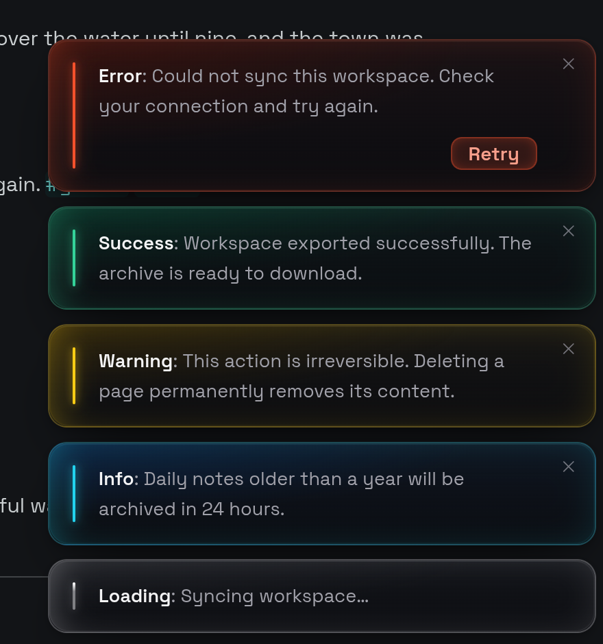
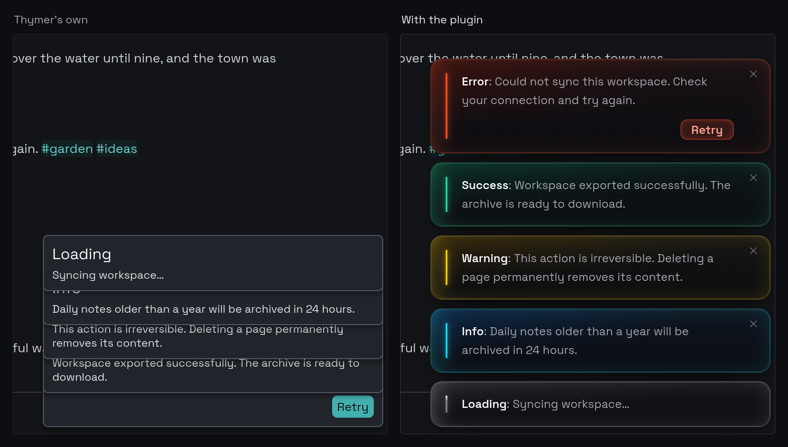

# BetterToast

Restyles Thymer's toasts (the notices in the corner) as dark tinted cards, each with an inner glow and a glowing accent line in the colour of its kind: error, warning, success, info or loading. It also stacks them by their real heights, newest nearest the edge, and lets a toast slide away when it goes instead of vanishing.

## What it does

- **Kinds.** Thymer's toasts carry no type, so the kind is guessed from the text: first from the title (for example "Error", "Warning", "Saved", "Info", "Syncing"), then from words in the title and message ("failed", "could not", "irreversible", "copied", "exported", a trailing "…", and so on). Anything else is info. Each kind has its own colour; a loading toast's accent line has a light running along it.
- **The card.** Title and message read as one line of prose ("Title: message"), the card is rounder and padded for the accent line, the close button is quieter, and the buttons are tinted with the kind's colour. On arrival a toast slides in from the side and its glow rises and settles.
- **Stacking.** Thymer stacks toasts a fixed 40px apart, oldest nearest the edge, so a taller card covers the one above and toasts with different lifetimes vanish from the middle of the pile. BetterToast re-stacks the toast area by arrival order, newest nearest the edge, using each toast's real height and a 10px gap. A new toast is placed without gliding; the others glide to their new places.
- **Leaving.** When Thymer removes a toast, a copy of it slides out beneath the remaining toasts, which glide over it.
- **Light themes** get pale cards with the same structure. The plugin picks the light or dark variant from the current theme and switches when the theme changes.

Toasts placed next to an element (not in the corner stack) are left where Thymer puts them. On mobile Thymer's own compact toasts stay as they are, and with reduced motion turned on in the system there are no entrance, glow or leaving animations.

## Commands

- `BetterToast: preview toasts` shows five sample toasts, one of each kind, a third of a second apart.

There are no settings.

## How it works

Nothing is inserted into Thymer's toast elements; only `data-bto` (the kind) and `data-bto-placed` are set on them, and `plugin.css` draws the card from those. A MutationObserver on the page notices toasts arriving and leaving; a second one watches each toast's style, so when Thymer writes its own positions the stack is put back. The leaving copy (`.bto-ghost`) lives on `<body>`, outside Thymer's DOM.

## Install

A global plugin: create one (Plugins → New → Global plugin), open **Edit Code**, paste `plugin.js` into the code tab, `plugin.css` into the **CSS** tab and `plugin.json` into the **Configuration** tab, and save.
