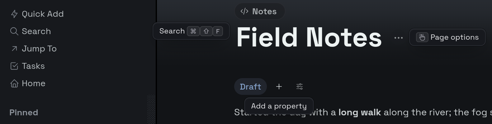
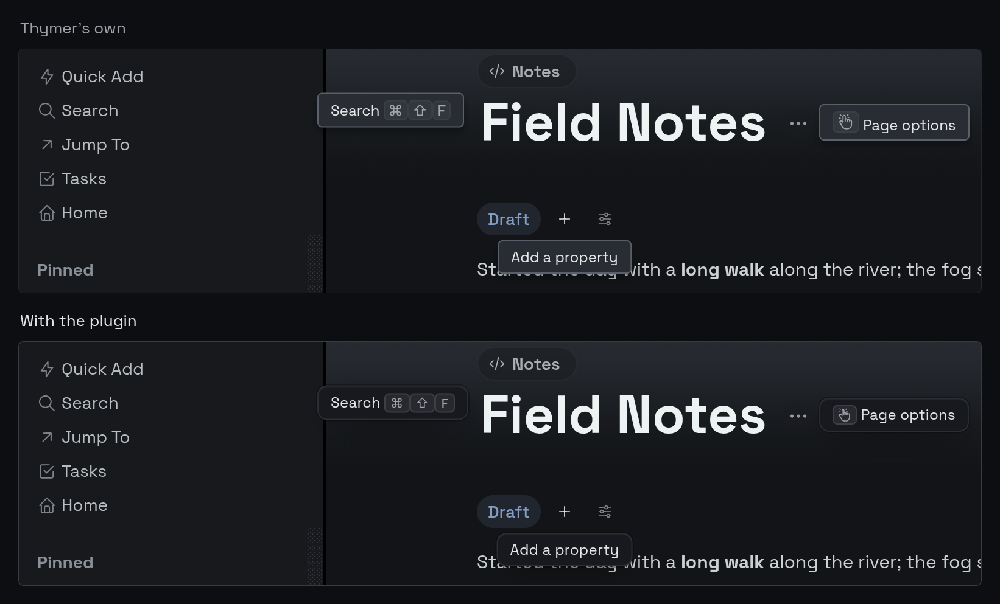
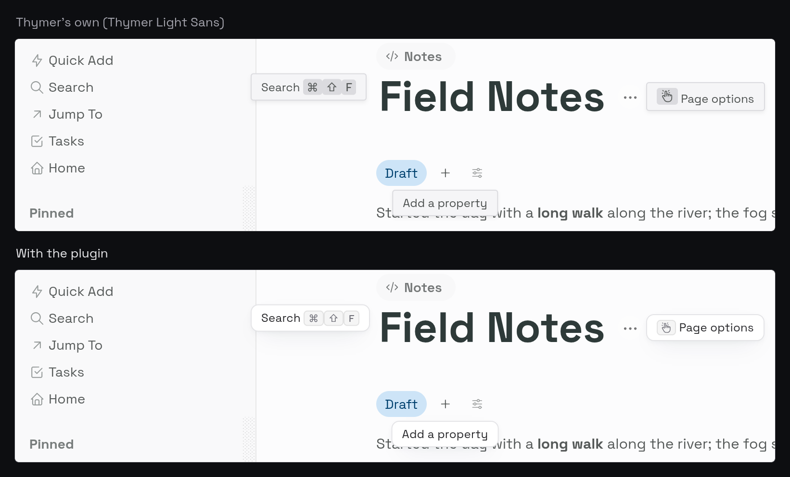

# BetterTooltip

Restyles Thymer's tooltips as small rounded pills with keyboard chips: a dark pill on dark themes, a white one on light themes, with a soft shadow and a short spring when a tooltip appears. Thymer still decides when and where every tooltip shows; the plugin changes only how it looks and the timing of its entrance.

## What it changes

- **The pill**: rounder corners, its own background, border and text colour, an inset highlight and a drop shadow, and the sans font.
- **Keyboard chips** (`.kbd`): small rounded chips with a thin ring, in a monospaced font. Where Thymer puts an icon on a chip (for example a click icon), the chip is sized for the icon.
- **Entrance**: Thymer moves tooltips with transforms by direction; those are left alone, and only their timing changes, to a quick fade with a slight spring. With reduced motion turned on in the system there is no transition.
- **Tall tooltips** (the multi-line kind) are fully opaque and a little rounder.

Thymer's arrows are drawn from its tooltip colour variables, so the plugin sets those too, but Thymer clips the arrows with `overflow: hidden`.

The plugin picks the light or dark variant from the current theme and switches when the theme changes. There are no commands or settings.

## Install

A global plugin: create one (Plugins → New → Global plugin), open **Edit Code**, paste `plugin.js` into the code tab, `plugin.css` into the **CSS** tab and `plugin.json` into the **Configuration** tab, and save. All the drawing is in `plugin.css`; `plugin.js` only switches the look on and picks the light or dark variant.
