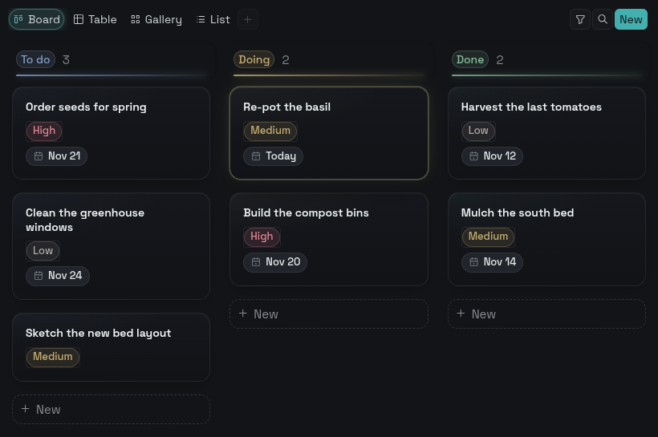
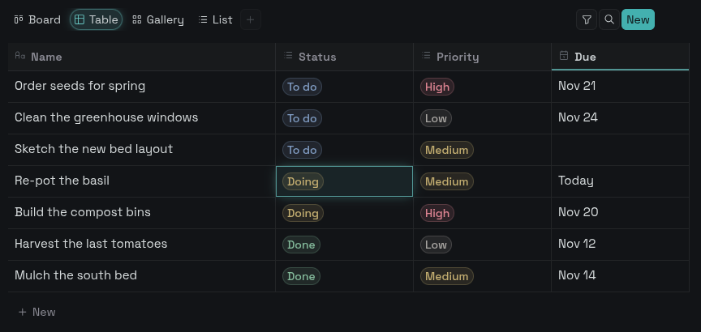
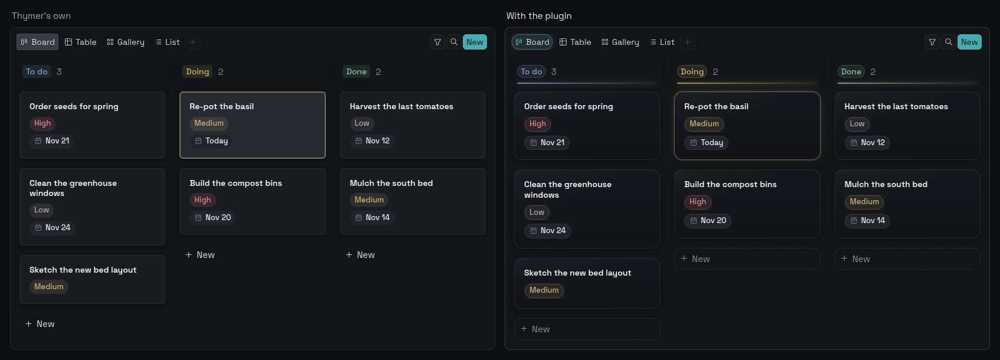

# BetterViews

Restyles Thymer's collection views as dark tinted cards: board cards and columns carry their column's colour, tables get quieter headers and a glowing focused cell, gallery and list cards match the board, the view switcher marks the active view as a pill, and choice values read as chips. Thymer still builds, sizes and places every card, cell and column; the plugin changes only colours, borders, radii and shadows (and lifts a hovered board card by a pixel).

## What it changes

- **Board.** Each card is a rounded card tinted from its top-left corner by its column's colour. Hovering a card lifts it a pixel and tints its edge; the focused card is outlined and glows in the column colour. Each column title has a glowing line in the column colour under it. "+ New" at the end of a column is a dashed outline. A card being dragged glows in the accent colour.
- **Gallery and list cards** get the same rounded, tinted card with hover and focus states, and list group labels are set in semibold.
- **Table.** Header cells are muted and smaller, with a faint background; the sorted column's header is brighter, with an accent line under it. Rows tint on hover, the focused cell is tinted and outlined in the accent colour (with a stronger ring while it is being edited), the "+ New" row is rounded, and sum cells use tabular figures.
- **View switcher.** The active view is a pill tinted in the accent colour, its icon in the accent colour.
- **Property pills.** Choice values (Thymer colours them per option) are round chips with a thin ring of their own colour. Property pills on cards have a thin border that strengthens on hover and glows while selected or edited.

The accent is the theme's primary colour. On phones the hover lift is off, as Thymer turns hover effects off there, and with reduced motion turned on in the system the cards do not animate.

There are light and dark variants; the plugin picks one from the current theme and switches when the theme changes. There are no commands or settings.

## Install

A global plugin: create one (Plugins → New → Global plugin), open **Edit Code**, paste `plugin.js` into the code tab, `plugin.css` into the **CSS** tab and `plugin.json` into the **Configuration** tab, and save. All the drawing is in `plugin.css`; `plugin.js` only switches the look on and picks the light or dark variant.
