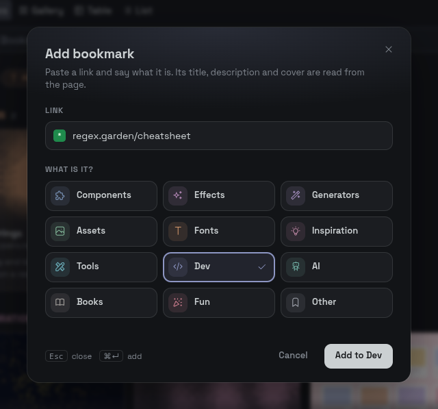

# Bookmarks

The code of a **collection** (not a global plugin) for saved sites. Its Bookmarks view lays them out as cards under their category, each with the site's preview image as its cover, its favicon, domain and description; a chip per category filters them, and an Add bookmark button opens a dialog that takes the link and what it is.

## The collection

The collection has the fields **URL** (url), **Description** (text) and **Category** (choice, one per bookmark). `plugin.json` holds them, the Category choices (Components, Effects, Generators, Assets, Fonts, Inspiration, Tools, Dev, AI, Books, Fun), the custom Bookmarks view, and Gallery, Table and List views. The code finds the fields by their labels, and the view must be in the configuration with `"type": "custom"` and the label `Bookmarks`.

## The Bookmarks view

The cards are laid out in one section per category, in the order the Category field lists them, then Other for bookmarks without one; within a section they are sorted by title.

- **Cover.** The record's banner is the card's cover, fading into the card. Without one, a cover is drawn for the site: soft shapes placed by its domain (so each site keeps its own), ordered-dithered in the category's colour.
- **Text.** The favicon and the title on one line (the favicon is the title's initial when the site has none at `/favicon.ico`), the domain when the title does not already say it, and two lines of description.
- **Colour.** Each card takes the most vivid colour of its cover (or the category's, for a cover with little colour): it is tinted with it, and its edge takes it under the pointer.
- **Clicks.** A click opens the site. The page button in the cover's corner, or a Cmd/Ctrl-click, opens the record in the other panel. The trash button beside it (both show under the pointer) asks in a small dialog, with Cancel focused, before moving the bookmark to Thymer's trash.
- **Filtering.** A chip per category, with its count, shows only that category (a second click shows all again); the chosen chip is kept while you switch to another view and back. Thymer's own search bar above the view filters the cards.

## Adding a bookmark

The **Add bookmark** button beside the chips, or `Bookmarks: add bookmark` from the command palette, opens a dialog:

- **Link.** A link on the clipboard is filled in; the site's favicon appears beside it.
- **What is it?** One tile per category, Other among them. The chosen chip, if any, is the tile chosen beforehand, and the button says where the bookmark goes ("Add to Dev").

Nothing is saved until both are given, so a bookmark never lands in Other by accident. Esc or a click outside closes the dialog, Cmd/Ctrl+Enter adds, and the arrow keys move between the tiles.

The page is then read for its title, description and preview image (`og:image`), which become the record's title, Description and banner (the image is uploaded to Thymer). Most sites do not let a page in Thymer read them (CORS); then the bookmark is saved with its domain as the title and no cover. Reading gives up after eight seconds. A link already saved is not added twice.

## Install

Create a collection, open **Edit as Code**, paste `plugin.json` into the **Configuration** tab (it holds the fields, the custom view and the Gallery, Table and List views), `plugin.js` into the code tab and `plugin.css` into the **CSS** tab, and save.
