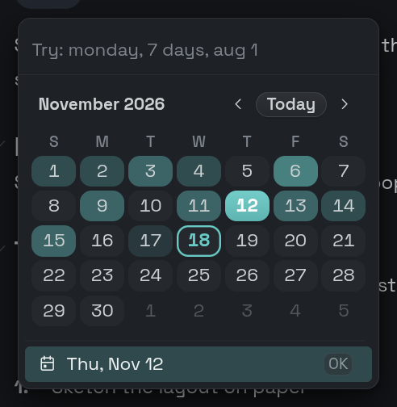
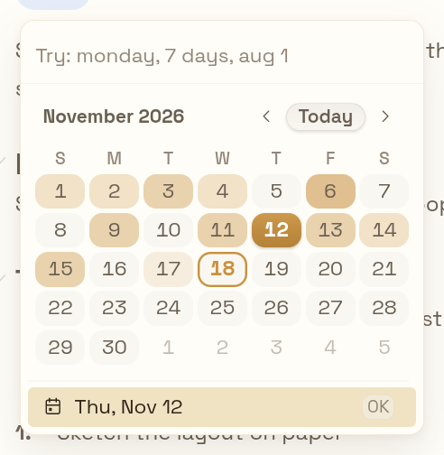

# Calendar Plus

Adds to Thymer's date picker wherever it opens: the journal's date popup, dates in properties and dates in the editor. The days become tiles that fill the grid, the days on which something changed in the workspace are tinted in the theme's accent colour (deeper the more changed), and a Today button in the header brings the calendar back to this month and picks today.

## What it does

- **Tiles.** The days are tiles that fill the grid instead of small numbers far apart. A last week that belongs wholly to the next month is hidden, and in the journal's popup (which has a fixed height) the tiles are sized by the number of weeks shown.
- **Activity.** A day on which something changed in the workspace is tinted in the accent colour, in four steps by how much changed; pointing at it says how many changes ("12 changes").
- **Today and the picked day.** Today has an accent ring and accent figures; the picked day has the accent gradient and white figures.
- **Today button.** Between the header's arrows, in place of Thymer's dot (which only went back to this month), a Today button brings the calendar to this month and picks today. Picking is Thymer's own click on the day, so what a pick does (in the journal, a property or the editor) stays Thymer's.
- **The popup.** The journal's popup is made as wide as the calendar, and the time row under the days (the switch, the time and + End date) is kept on one line.

The colours come from the theme's own variables, so it fits any theme, light or dark.

There are no commands and no settings.

## How it works

What changed when is counted the way the Home plugin counts it: a page scores 2 on the day it was made, and each line scores 1 on the day it was written and 1 on the day it was last changed. A day's score sets its tint: 1 or more, 3 or more, 10 or more, 30 or more. The workspace is read about four seconds after Thymer starts, and again when a calendar opens and the last read is older than two minutes; a calendar that is open when a read ends is tinted then.

The plugin SDK has no hook for the date picker, so one MutationObserver watches the page: a new `.datepicker-calendar` gets the Today button, and every time Thymer draws the days (it rebuilds `.datepicker-days` on each month change and pick), the new day elements are tinted from their `data-date`.

## Install

A global plugin: create one (Plugins → New → Global plugin), open **Edit Code**, paste `plugin.js` into the code tab, `plugin.css` into the **CSS** tab and `plugin.json` into the **Configuration** tab, and save.
