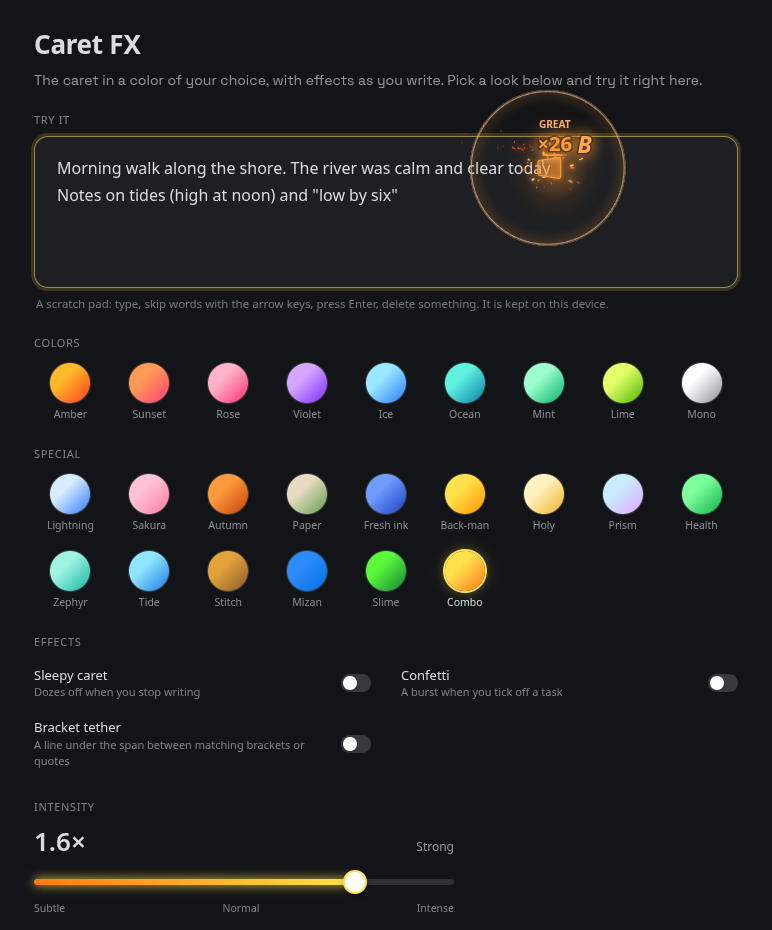
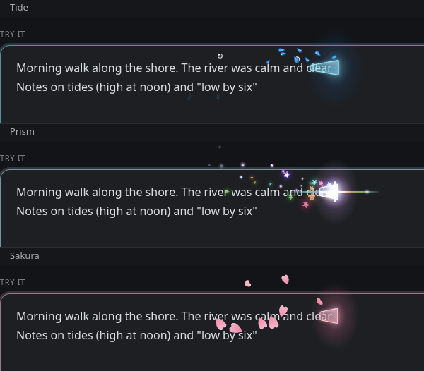
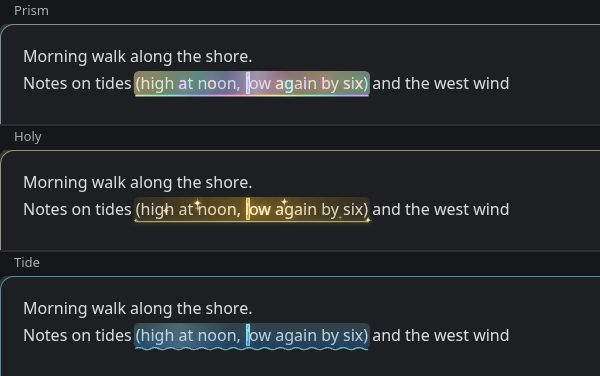

# Caret FX

Effects on the typing caret in Thymer's editor. The caret becomes a small glass block the width of the letter it stands on, in a color of your choice (even when you are not typing), and reacts as you write: a soft glow on each key, a stretch as it moves, and, with a special preset, an effect of its own such as falling petals, lightning, sprays of water, a holographic burst or a combo counter. A settings page with a scratch area lets you try every preset before you keep it.



## What it does

Always on:

- **Glow** – a soft halo opens round the caret on each keystroke (taller than wide, hugging the caret) and the caret flares for an instant.
- **Motion smear** – the caret stretches as it moves and snaps back when it arrives, on a spring, to another line as well as along one. While you type, only its tail trails.

Pick one preset at a time on the settings page. **Colors** only set the caret's color and accent: Amber, Sunset, Rose, Violet, Ice, Ocean, Mint, Lime, Mono. **Special** presets bring colors and an effect of their own:

| Preset | Effect |
| --- | --- |
| Lightning | blue crackles jump off the caret now and then while typing, and a bolt strikes when the caret changes line, with a flash where it lands |
| Sakura | pink petals drift off the caret (roughly one letter in three drops one); a new line shakes a few loose at once |
| Autumn | orange and red leaves fall, likewise |
| Paper | green leaves fall, likewise |
| Fresh ink | the letters you just typed stay wet in the caret color and dry into the text over a second or two |
| Back-man | while Backspace or Delete eats text, the caret becomes a little creature that takes one bite per letter and gulps it down; a word or a selection is one big bite |
| Holy | tiny golden star glints (a couple of pixels) twinkle slowly on and around the caret, in place, like light catching a gem, and the caret keeps glinting for a moment after you stop |
| Prism | a burst of light through glass: every letter flashes on the caret with a thin lens streak that runs through the colors of holographic foil (aqua, lavender, pink, peach, yellow, mint) round a white heart, and a pink lens-orb, and flings chunky glowing stars in those same pastels (some aqua ones with tails) that slow down, spin and fade, with pearly embers drifting among them; a new line or a jump is a big burst |
| Health | tiny glowing pluses, a few pixels across like Holy's glints, rise slowly out of the caret as you write, each with a short trail of light behind it, and a soft glow opens on the caret; in the preset's greens, or in other colors set in the configuration (a red cross, say) |
| Zephyr | an anime-style wind skill: pointed, cel-shaded leaves are swept up round the caret and off behind it, fluttering, while thin speed lines streak back from the caret; a new line or a jump is a full gust |
| Tide | a stylized water skill: every letter flicks a small spray of teardrops (round head, tapering tail, white glint) out of the caret to arc up and fall back, and now and then a bubble drifts up and pops; a new line or a jump is a big splash |
| Stitch | a running stitch is sewn under the line as you write, each stitch pulled through as it is typed, with a needle-hole at either end; the stitches hold a moment and are drawn out, oldest first; Backspace unpicks the ones it passes back over, and a new line ties a small cross-stitch knot. The thread is the caret's color |
| Mizan | while you write, a small Stat floats over the caret on frosted glass: a live sparkline of your pace over the last keys, the pace in words a minute and a change badge (▲ green when you speed up against the start of the run, ▼ red when you slow down), with a border beam running round its edge, quicker the faster you write; it follows the caret and fades when you stop. When the caret jumps (a click, the arrows, a new line) a raised pill glides there on a spring |
| Slime | the caret is a block of jelly: its base stays put and its top lags and rocks; at rest it sways and breathes, every letter kicks it the way it moves, and a new line or a jump squashes it flat and draws it out from where it was to where it lands |
| Combo | typing as a game: every letter in a run adds one to a counter above the caret that follows it on a spring, rolls its digits as they change and pops with each hit; it runs down if you pause (a bar under it flashes red when the run is nearly out). A new mark (NICE, GREAT, SUPER, ULTRA at 10, 25, 50, 100) sends a shockwave out from the caret, bursts into sparks and earns a rank letter (C, B, A, S) that stays beside the counter; the caret itself changes color with the count - red from 10, orange from 25, blue from 50, white-hot blue from 100 - and throws sparks, more of them the higher you go. A broken run of ten or more shatters and its pieces fall |

Holy, Prism, Health, Zephyr and Tide answer writing, not deleting.



Three more effects are switches on the settings page, off until switched on:

- **Sleepy caret** – after a while without writing (`sleepAfterMs`, 15000) the caret sinks, dims and breathes, little z's float up from it, and any key or move wakes it with a stretch.
- **Confetti** – a task you tick off (a click on its box or a key) bursts into confetti from its checkbox (`confettiCount`, 46). A task that is drawn already done, or ticked by a sync, stays quiet.
- **Bracket tether** – works alongside any preset: the span between the matching brackets or quotes around the caret is marked in the style of the preset, a highlight behind the whole of it and what the preset does in it, always faint enough to read through. It follows a span that wraps onto more lines.



How Bracket tether looks with each preset:

- Colors, Fresh ink, Stitch and Mizan: a highlighter with a rule and a tick at each end.
- Lightning: a faint blue glow, and every second or two a bolt comes down into it - the highlight and the rule blaze white-blue, a second weaker flash follows - and the letters are struck outward from where it landed.
- Sakura, Autumn, Paper: a tint and a rule; now and then a petal or a leaf comes away and falls through the letters.
- Holy: a golden glow, glints twinkling all through it and a light passing over the letters.
- Prism: holographic foil behind it - pastel bands of aqua, lavender, pink, peach, yellow and mint sliding diagonally, a silver sheen sweeping over them - letters catching the light here and there, and a foil rule.
- Health: a green glow, pluses rising out of it.
- Zephyr: a gust sweeping over it, wisps of wind that end in curls along its edges, leaves carried along, and the letters in the gust really lean to the right and come back (the letters of the span are made transparent where they are, by a highlight in the plugin's CSS, and drawn on the canvas instead - upright in still air, slanted in the gust, which reads the span in order, line after line).
- Tide: under water - a blue tint that deepens toward the bottom of each line, a slow ripple of light passing over it and a quiet wave for a rule.
- Slime: swallowed by a jelly with a wobbling edge, a gloss, bubbles and drops.
- Combo: in the color of the rank, sparks rising, letters glowing from rank B.
- Back-man: a yellow wash and a plain rule.

The tether is a plain depth count over one line's text, not a syntax-aware match, and only shows for a collapsed caret (not over a selection). Angle brackets are left out.

## The settings page

Run `Caret FX: open settings` from the command palette. It opens a page in the panel you are working in, the way a note opens. On it:

- **Try it** – a scratch area to type in, where the caret and its effects run for real (skip words, press Enter, delete something); what you type there is kept on this device.
- **Colors** and **Special** – the presets above.
- **Effects** – the switches Sleepy caret, Confetti and Bracket tether.
- **Intensity** – a slider from 0.3× (subtle) to 2× (intense); it also scales petals, leaves, crackles, glints, prism stars and pluses.

Other command: `Caret FX: next preset` cycles through every preset (colors first, then the special ones) and shows the new one in a toast.

On a light theme the caret's colors are darkened automatically.

## Settings

What you choose on the page and with the command (preset, switches, intensity) is remembered per device, in the app's local storage, and wins over the Configuration JSON, which is the place for defaults and tuning. Everything goes under `custom`, and every key is optional:

```json
{
  "color": "#ffb929",
  "accent": "#ff3b1f",
  "fx": null,
  "intensity": 1,
  "sleep": false,
  "confetti": false,
  "tether": false
}
```

- `fx` is `null` (a color preset) or one of `"lightning"`, `"sakura"`, `"autumn"`, `"paper"`, `"ink"`, `"backman"`, `"holy"`, `"prism"`, `"health"`, `"zephyr"`, `"tide"`, `"stitch"`, `"mizan"`, `"slime"`, `"combo"`. Choosing a preset on the page sets `color`, `accent` and `fx` for you.
- `color` and `accent` are the dark-theme pair.
- `sleep`, `confetti` and `tether` are the three switches.

Tuning, with the defaults:

| Key | Default | What it sets |
| --- | --- | --- |
| `lightningMinLines` | 0.8 | how far the caret must jump, in caret heights, for Lightning's bolt |
| `smearStiffness` | 0.65 | Motion smear: the leading edge's spring |
| `smearTrailingStiffness` | 0.15 | Motion smear: how fast the tail follows |
| `smearDamping` | 0.4 | Motion smear: damping |
| `inkMs` | 1500 | Fresh ink: how long the ink takes to dry |
| `inkStrength` | 0.8 | Fresh ink: how strong the wet color is (0 to 1) |
| `tetherStrength` | 0.35 | Bracket tether: opacity (0 to 1) |
| `holySize`, `prismStrength`, `healthSize`, `zephyrSize`, `tideSize`, `stitchSize` | 1 | the size or strength of that preset's effect (1 is normal) |
| `slimeIdle` | 1 | how far Slime sways at rest (0 holds it still) |
| `comboWindowMs` | 1400 | how long a Combo run waits for the next letter |
| `sleepAfterMs` | 15000 | how long Sleepy caret waits before it dozes off |
| `confettiCount` | 46 | pieces in a confetti burst |

The `plugin.json` in this folder starts from the Zephyr preset at an intensity of 0.9.

## How it works

Thymer draws its caret as the left border of `div.listview-caret-self`. The plugin hides that element with opacity (its box is still measured on every move) and draws a block of the letter's width in its place; inputs and dialogs keep their own caret. Effects are drawn on a transparent canvas above the app, clipped to the editor's scroll area so they do not paint over the title bar, the status bar or neighbouring panels, and nothing in the editor's DOM is modified. Typing in the command palette, menus and dialogs is ignored.

The plugin SDK has no caret, selection or text-layout API, so Fresh ink, Bracket tether and Back-man read the caret's line from the DOM: what was typed or deleted is worked out by comparing the line before and after each key.

## Credits

Motion smear, Fresh ink, Bracket tether and Back-man are ported from [Sadsnake1/cursor-smith](https://github.com/Sadsnake1/cursor-smith) (MIT, version 1.8.1), an Obsidian plugin, and adapted to Thymer's editor. Cursor-Smith's copyright and license notice are kept at the top of `plugin.js`, and each effect names the files it follows.

The plugin started from the Ghostty cursor shaders `cursor_blaze` (based on [this gist](https://gist.github.com/chardskarth/95874c54e29da6b5a36ab7b50ae2d088)) and `cursor_lightning`; Lightning is a Canvas 2D re-implementation of `cursor_lightning`. Finding Thymer's caret element and variables, and measuring carets in inputs, follows the approach in [akaready/thymer-cursor-tweaks](https://github.com/akaready/thymer-cursor-tweaks).

Mizan is drawn in the language of Mizan, the component library from pano-ui: its Stat, Sparkline, border beam and the sliding pill of its Segmented control.

## Install

Caret FX is a global plugin:

1. In Thymer, create a new global plugin (Plugins → New → Global plugin).
2. Open **Edit Code** and paste `plugin.js` into the code tab.
3. Paste `plugin.css` into the **CSS** tab.
4. Paste `plugin.json` into the **Configuration** tab and save.
