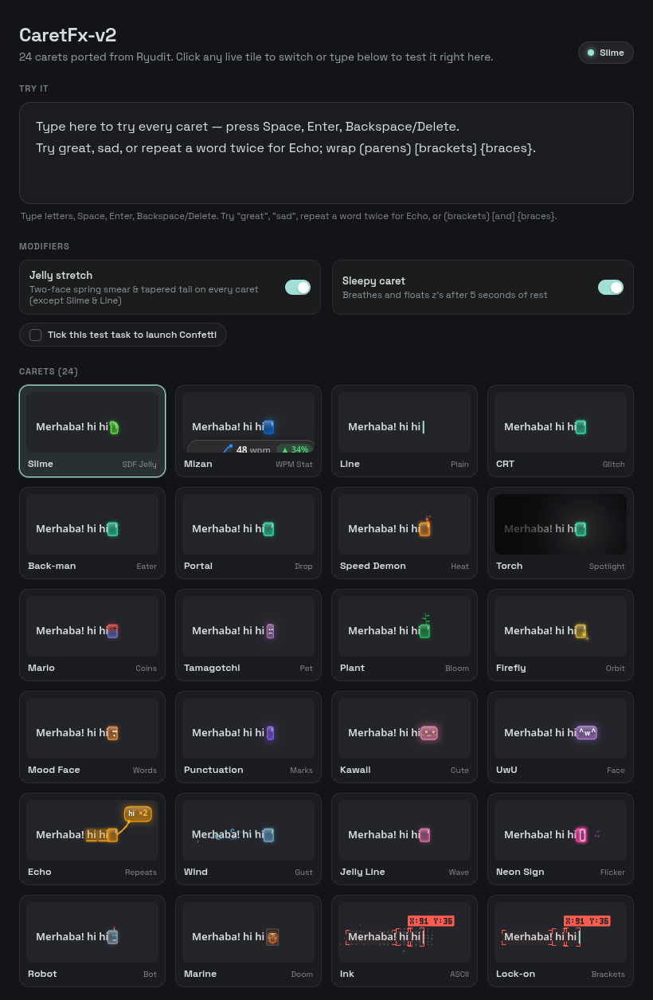
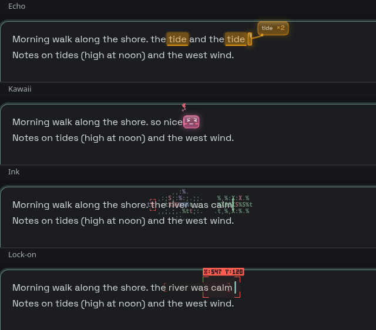
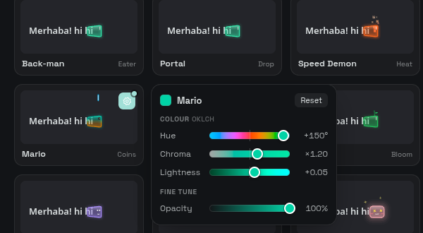

# CaretFx-v2

24 carets for Thymer's editor, ported from Ryudit (Celestine): a jelly that sways, a live words-a-minute stat, a CRT block that glitches, a creature that eats what you delete, a pet you feed by writing, a plant that grows a leaf for every word, a Doom-style face, ASCII ink and more. Each one replaces Thymer's caret while you write and reacts to what you type, delete and where you jump. A settings page shows every caret as a live tile, with a scratch pad to try the chosen one and a gear on each tile to tune its colour.



## The carets

Pick one by clicking its tile on the settings page, or cycle through them with `CaretFx-v2: next caret`.

| Caret | Tag | What it does |
| --- | --- | --- |
| Slime | SDF Jelly | a block of jelly whose base stays put while its top lags and rocks; at rest it sways and breathes, and when it moves a strand and a drop stretch from where it was to where it goes |
| Mizan | WPM Stat | a small stat floats over the caret while you write: a sparkline of your pace, words a minute and a change badge, with a border beam running round it; when the caret jumps it glides there on a spring |
| Line | Plain | a plain line caret |
| CRT | Glitch | a glass block that leaves fading ghosts where it was; a space, Enter or a long jump sets off an RGB-split scanline glitch |
| Back-man | Eater | while Backspace or Delete eats text, the caret takes one bite per letter, with an eye that squints as it gulps; more than one letter at once is a big bite |
| Portal | Drop | deleted letters drop through a glowing floor under the caret |
| Speed Demon | Heat | the caret heats up as you type (grey, amber, orange, white-hot) and cools when you stop; once hot it throws sparks |
| Torch | Spotlight | the editor goes dark except for a spotlight that follows the caret |
| Mario | Coins | a red-and-blue caret with an eye that looks the way you are writing; every space makes it hop and pops a spinning coin |
| Tamagotchi | Pet | a pet with eyes and a mouth that you feed by writing: it grows, brightens and smiles as it is fed, gets hungry when you stop, and sends up hearts every 100 letters |
| Plant | Bloom | every space grows a leaf on a stem above the caret (up to eight), Enter makes it bloom, and deleting drops leaves |
| Firefly | Orbit | every four letters add a firefly circling the caret (up to 14); when you pause they drift away |
| Mood Face | Words | a face that reacts to the words you finish (happy for words like great, good, love, thanks; sad for sad, bad, tired, sorry; angry for angry, hate; Turkish words too), to `!` and `?`, and pulls a face of its own when you delete |
| Punctuation | Marks | each of `.` `,` `?` `:` `;` `-` gets a short animation of its own, and `!` throws a burst of sparks |
| Kawaii | Cute | a cute face with ten modes (see below) |
| UwU | Face | a `w`-mouthed face with ten modes (see below) |
| Echo | Repeats | when you finish a word that is already in the text, every copy of it lights up in one colour and a sign above the caret shows the word and how many times it appears |
| Wind | Gust | typing and deleting stir up a wind that blows ribbons and flecks past the caret and makes the letters around it lean; Enter is a gust |
| Jelly Line | Wave | the letters around the caret wobble and squash like jelly as you type or delete |
| Neon Sign | Flicker | a pink neon box that now and then flickers off with a buzz; Enter makes it flash |
| Robot | Bot | a steel caret with an antenna light that blinks with each letter; deleting makes it say oops with a red `!` |
| Marine | Doom | a pixel-art marine's face: it grins when you type fast, flinches when you delete (the deleted letters burst into bits), and a space is a shot |
| Ink | ASCII | typing splashes ink made of the characters `.,:;t%SX8#@` round the caret, in a hue that changes with each word; deleting dissolves the letters into rose ink, and a long jump leaves a streak |
| Lock-on | Brackets | every word you finish, and every place the caret jumps to, is locked onto with targeting brackets and an `X:… Y:…` tag |



### Kawaii and UwU modes

Both faces have an **Auto** mode, the default, that changes the face as you write: it reacts to typing, speed, punctuation, deleting and jumps. With Kawaii, for example, `!` brings hearts, `?` a curious look, `:` `;` or `~` (or a long run of letters) a cat face, fast typing stars, deleting a teary face, a long jump a dizzy one, and a pause a cozy face with music notes. The other modes hold one face:

- Kawaii: Classic, Joy, Neko, Love, Starry, Teary, Curious, Dizzy, Cozy.
- UwU: u w u, ^ w ^, O w O, > w <, ♥ w ♥, T w T, ¬ w ¬, X w X, ~ w ~.

When Kawaii or UwU is the caret, the settings page shows its modes as buttons. `CaretFx-v2: next Kawaii / UwU mode` moves to the next mode (and switches to Kawaii if neither is the caret).

### Shared modifiers

- **Jelly stretch** (on by default) – the caret stretches into a two-face spring smear with a tapered tail as it moves, on every caret except Slime and Line.
- **Sleepy caret** (on by default) – after a rest (`sleepAfterMs`, 5 seconds) the caret breathes and floats z's.
- **Confetti** – a task you tick off bursts into confetti from its checkbox, tinted with the caret's colour. The settings page has a test task to try it.
- **Caret style from text** – inside strikethrough the caret splits horizontally; inside `()`, `[]` or `{}` its corners turn rounded, square or chamfered.

## The settings page

Run `CaretFx-v2: open settings` from the command palette. It opens a page in the panel you are working in, the way a note opens, with:

- a pill at the top naming the caret in use,
- **Try it** – a scratch pad where the chosen caret runs for real; what you type there is kept on this device,
- **Modifiers** – the Jelly stretch and Sleepy caret switches, and the confetti test task,
- the Kawaii or UwU modes when one of those is the caret,
- **Carets (24)** – a live, animated tile for each caret; click one to use it.

Each tile has a gear that opens a tune popup beside it: the caret's colour in OKLCH (Hue turned by up to ±180°, Chroma scaled from 0 to 2×, Lightness moved by up to ±0.4) and its Opacity (15% to 100%), each on a slider whose track is drawn in the colours it gives. Changes show at once on the tile and on the caret. Double-click a slider to put it back, or press Reset to put them all back; the arrow keys move a focused slider (with Shift, ten steps at a time), and Escape or a click outside closes the popup. The tune is relative, so a caret with a palette of its own (Mario, Marine, Mood Face, Ink) keeps it, turned as a whole, and near-grey colours (gloss, shadows, redrawn text) change only in opacity. A tuned caret's gear carries a small dot.



## Commands

- `CaretFx-v2: open settings`
- `CaretFx-v2: next caret` (shows the new caret in a toast)
- `CaretFx-v2: toggle jelly`
- `CaretFx-v2: toggle sleepy caret`
- `CaretFx-v2: next Kawaii / UwU mode`

## Settings

What you choose on the page and with the commands is kept per device, in the app's local storage, and wins over the Configuration JSON. The defaults go under `custom`:

```json
{
  "caret": "Slime",
  "jelly": true,
  "sleep": true,
  "sleepAfterMs": 5000,
  "kawaiiMode": "auto",
  "uwuMode": "auto"
}
```

- `caret` takes a caret's name or label, in any case: `Slime`, `Mizan`, `line`, `CRT`, `Back-man`, `portal`, `speedDemon`, `torch`, `Mario`, `Tamagotchi`, `plant`, `firefly`, `moodFace`, `punctuation`, `Kawaii`, `UwU`, `echo`, `wind`, `jellyLine`, `neonSign`, `Robot`, `Marine`, `ink`, `lockOn` (or `Speed Demon`, `Lock-on` and so on). An unknown name falls back to Slime.
- `sleepAfterMs` is kept between 1000 and 120000.
- `kawaiiMode` is `auto`, `classic`, `happy`, `neko`, `love`, `starry`, `shy`, `curious`, `dizzy` or `cozy`; `uwuMode` is `auto`, `uwu`, `happy`, `owo`, `turbo`, `love`, `cry`, `smug`, `dizzy` or `cozy`.
- `tune` holds the per-caret tunes the gear sets, by caret name, as `{ "h": 0, "c": 1, "l": 0, "a": 1 }` (hue in degrees, chroma factor, lightness shift, opacity factor).

## How it works

The plugin follows Thymer's own caret element (`div.listview-caret-self`), hides it, and draws the chosen caret on a canvas over the app; typing in the command palette, menus and dialogs is ignored. The plugin SDK has no caret or text-layout API, so what was typed or deleted is worked out from the caret's line in the DOM, before and after each key. Carets that move letters (Wind, Jelly Line) make the real letters transparent with a CSS highlight and draw them again on the canvas. CaretFx-v2 keeps its choices and scratch pad apart from Caret FX's (its own local-storage keys and settings page).

## Credits

The 24 carets and the Jelly, Sleepy caret and text-style modifiers are ported from Ryudit (Celestine); each caret in `plugin.js` names the Ryudit source file it follows (`slime.go`, `mizan.go`, `caretfx_look.go` and so on), and the canvas drawing helpers mirror its `ui.Painter`. No licence text for Ryudit is included in this folder.

## Install

CaretFx-v2 is a global plugin:

1. In Thymer, create a new global plugin (Plugins → New → Global plugin).
2. Open **Edit Code** and paste `plugin.js` into the code tab.
3. Paste `plugin.css` into the **CSS** tab.
4. Paste `plugin.json` into the **Configuration** tab and save.
