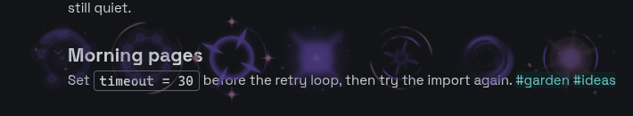
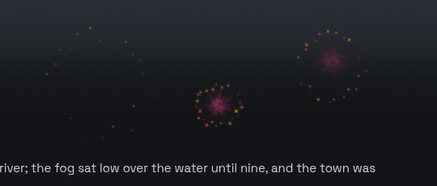
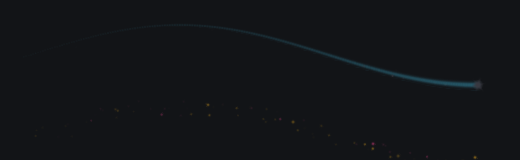

# Cursor FX

Effects for the mouse, in presets made to go together. Each preset puts together a click effect, a trail behind the pointer (a comet, fairy dust, or none), a size and two colours: a main one, and an accent that some parts of each effect take (a comet's head, every third star of a firework).



## Presets

| Preset | Click | Trail |
| --- | --- | --- |
| Frost | a ripple | a comet |
| Arcane | one of seven spells each click: pentagram, heptagram, compass, nova, twin rings, vortex, sun sigil | fairy dust |
| Festival | fireworks | golden dust |
| Sweetheart | hearts | pink sparkles |
| Quiet | a small ripple | none |

Arcane's spells come in a shuffled order, never the same twice running.





## Commands

- `Cursor FX: choose preset…` opens a dialog with the presets as cards and an on/off switch. Pick one, then click and move the pointer to try it; the dialog stays open until you close it.
- `Cursor FX: next preset` moves on to the next preset.
- `Cursor FX: turn on or off`.

The choice is kept per device (the app's local storage).

## Settings

The defaults sit under `custom` in the plugin's Configuration JSON; a choice made with the commands on a device is laid over them.

```json
"custom": {
  "on": true,
  "preset": "frost"
}
```

`preset` is one of `frost`, `arcane`, `festival`, `sweetheart`, `quiet`.

## How it works

Everything is drawn from small grayscale textures, tinted with the preset's colours, as instanced WebGL particles on one transparent canvas over the whole window that clicks pass through. It draws only while something is alive, so standing still costs nothing. On a dark theme the light adds up; on a light theme the colour is darkened and painted over, so it stays visible. It stays off on phones and tablets and with reduced motion.

## Credits

The textures are CC0 (public domain): Kenney's [Particle Pack](https://opengameart.org/content/particle-pack-80-sprites) for the sprites and a "Perlin 1" noise from Screaming Brain Studios' [700+ Noise Textures](https://opengameart.org/content/noise-texture-pack). `fx/LICENSE.md` lists which sprites are used and how they were changed.

## Install

A global plugin: create one (Plugins → New → Global plugin), open **Edit Code**, paste `cursor-fx.js` (the built plugin, textures included) into the code tab, `plugin.css` into the **CSS** tab and `plugin.json` into the **Configuration** tab, and save.

`cursor-fx.src.js` is the source. To rebuild after editing it, run `node build.mjs` in this folder: it bakes `fx/atlas.png` and `fx/noise.png` into `cursor-fx.js`.
