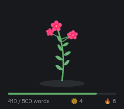
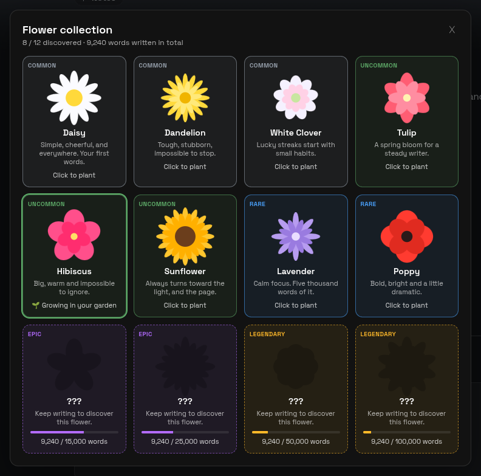

# Digital Garden

A sidebar plant grows with every word you write today and blooms with every task you finish. Hit the daily goal to keep a streak. The words you write over time also unlock a collection of 12 flowers, from Common to Legendary; plant one you have unlocked and the sidebar plant blooms with it.



## The plant

The plant grows taller and puts out leaves as today's word count nears the daily goal (500 words unless you set another), and gets a flower for each task you mark done. When the goal is reached it is in full bloom, fireflies glow around it, and the streak goes up; the streak carries on only if the goal was also reached the day before. A new day grows a new plant, its shape seeded from the date.

Under the plant are a progress bar and today's words, tasks done and streak. The status bar shows today's words against the goal.

Words are counted as they are typed, line by line: only words added to a line count, and deleting words does not take any away.

## Flower collection

Click the word counter in the status bar (or run `Daily Garden: open flower collection`) to open the collection. Flowers unlock by **lifetime words written**:

| Rarity | Flowers (words) |
| --- | --- |
| Common | Daisy (100), Dandelion (300), White Clover (600) |
| Uncommon | Tulip (1,200), Hibiscus (1,800), Sunflower (2,500) |
| Rare | Lavender (5,000), Poppy (8,000) |
| Epic | Orchid (15,000), Lotus (25,000) |
| Legendary | Celestial Rose (50,000), Moonflower (100,000) |



Click an unlocked flower to plant it in the sidebar garden. Locked flowers show how far you are from them. Progress is stored in the app's local storage, so it is per device. Thresholds live in the `FLOWERS` list at the top of `plugin.js`.

## Commands

- `Daily Garden: toggle sidebar plant` shows or hides the sidebar plant; the choice is remembered on this device (the app's local storage).
- `Daily Garden: open flower collection`.
- `Daily Garden: set daily word goal`.
- `Daily Garden: reset today's plant` (does not touch the collection).

## Settings

Without a choice made with the toggle command, `"showSidebar"` under `custom` in the plugin's Configuration JSON decides whether the sidebar plant shows: it is hidden unless that says `true`. The `plugin.json` in this folder sets it to `true`.

```json
"custom": {
  "showSidebar": true
}
```

Word counting, the status bar counter and the collection work either way.

## Install

A global plugin: create one (Plugins → New → Global plugin), open **Edit Code**, paste `plugin.js` into the code tab, `plugin.css` into the **CSS** tab and `plugin.json` into the **Configuration** tab, and save.
