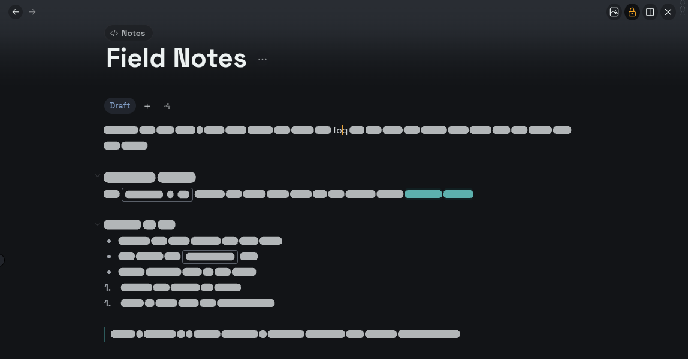
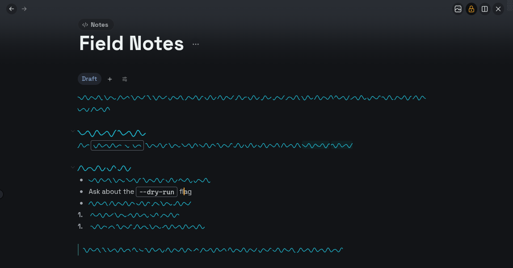
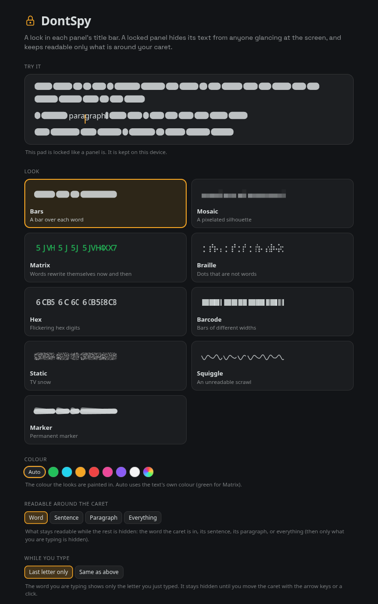

# DontSpy

A lock in each panel's title bar, left of the split-view button. A locked panel hides what is written in it from anyone glancing at the screen. What stays readable is a window around the caret: its word, its sentence, its paragraph, or everything; while you type, the word you are typing shows only its last letter.



## Using it

- Click the lock to lock or unlock that panel. An unlocked panel shows the lock dimmed; a locked one shows it lit.
- Right-click the lock (or Shift-click or Alt-click it) for quick options: the look, the colour, what stays readable, what happens while you type, and whether new panels start locked. Escape or a click elsewhere closes it; **All settings…** opens the settings page.
- While you type, the word you are typing shows only the letter you just typed. It stays that way until you move the caret on with the arrow keys (or Home, End, Page Up, Page Down) or a click, or, if you chose it, until you pause for 3 seconds.

The page title, the sidebar and the tabs are not hidden.

### Looks

Bars, Mosaic, Matrix, Braille, Hex, Barcode, Static, Squiggle and Marker, in the text's own colour (green for Matrix) or one you pick: one of seven swatches or any colour from a picker.

| Look | What stands in for the text |
| --- | --- |
| Bars | a bar over each word |
| Mosaic | a pixelated silhouette of the word |
| Matrix | green letters and digits; now and then each word is typed over with new ones |
| Braille | braille dots that are not words |
| Hex | flickering hex digits |
| Barcode | bars of different widths |
| Static | TV snow |
| Squiggle | an unreadable scrawl |
| Marker | a permanent-marker stroke |



### The settings page

`DontSpy: open settings` opens a page in the current panel with a pad to try it on (locked like a panel, its text kept on this device), a gallery of the looks with live samples, and the other choices.



### Commands

- `DontSpy: open settings`
- `DontSpy: lock or unlock this panel`
- `DontSpy: lock all panels`
- `DontSpy: unlock all panels`
- `DontSpy: quick options`
- `DontSpy: next style`

## Settings

What you choose on the lock, the settings page or with the commands is kept per device (the app's local storage) and laid over the defaults in the Configuration JSON. Saving the configuration reloads the plugin, so a click cannot change it; edit it there to change the defaults.

```json
"custom": {
  "style": "bars",
  "color": null,
  "scope": "word",
  "typing": "last",
  "pause": 0,
  "startLocked": false
}
```

- `style`: `bars`, `mosaic`, `matrix`, `braille`, `hex`, `barcode`, `static`, `squiggle` or `marker`.
- `color`: `null` for each look's own colour, or a colour such as `"#22d3ee"`.
- `scope`: what stays readable around the caret: `word`, `sentence`, `paragraph` or `all` (with `all`, only what you are typing is hidden).
- `typing`: `last` (the word being typed shows only its last letter) or `scope` (while typing, the same stays readable as at any other time).
- `pause`: `0` to stay hidden, or milliseconds after which a paused word shows again (the options offer 3000).
- `startLocked`: lock every panel as it opens.

## How it works

The real glyphs are made transparent with the CSS Custom Highlight API (a highlight over every stretch of text to hide, painted by `::highlight(dontspy-ink)` in `plugin.css`); the page's DOM is never touched, so editing, undo, sync and other plugins see the text as it is. A canvas over the window paints the mask in their place, each hidden character's box read back from the page. Thymer's editor draws its caret and its selection as layers of their own, so the caret is found from its element, and the selection's rectangles are painted again over the masks; selected text stays masked. On a very long page, past 9000 characters, the text is still hidden but no mask is drawn over it. Thymer versions without the Custom Highlight API get a message that the text cannot be hidden.

## Install

A global plugin: create one (Plugins → New → Global plugin), open **Edit Code**, paste `plugin.js` into the code tab, `plugin.css` into the **CSS** tab and `plugin.json` into the **Configuration** tab, and save.
