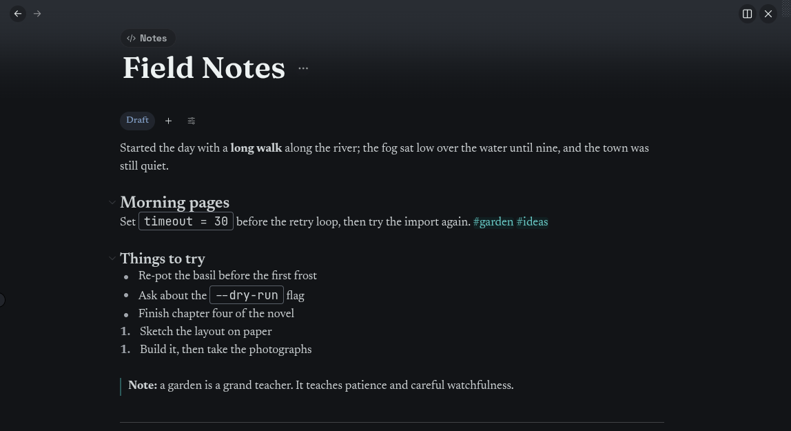
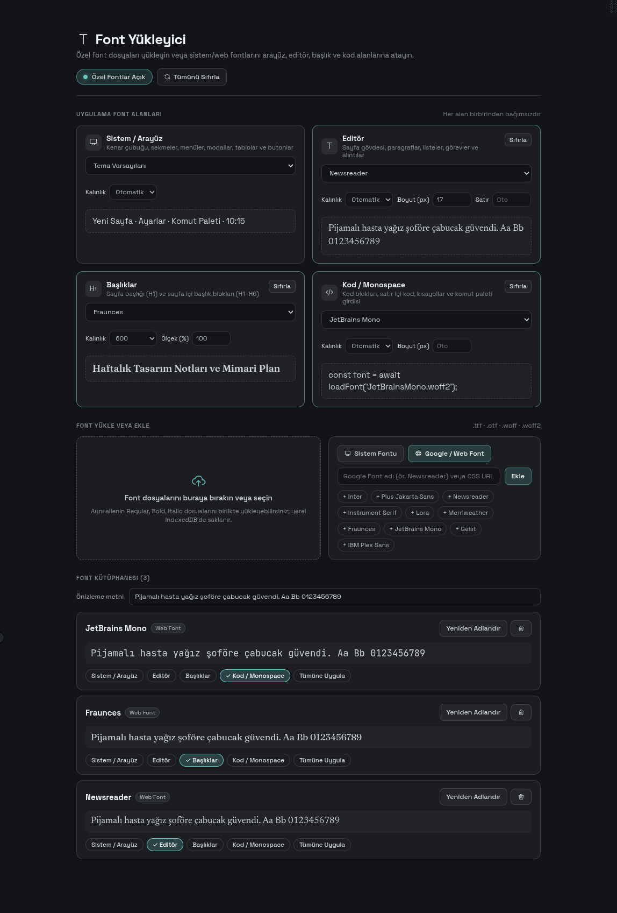

# Font Loader

Sets the fonts Thymer uses, in four places that are set apart from each other: the interface, the editor, headings, and code. A font can be a file you upload (.ttf, .otf, .woff, .woff2), a font installed on your system, or a Google or other web font. The font manager page is in Turkish; the labels are translated below.



## The font manager

`Font Loader: open font manager` opens a page ("Font Yükleyici") in the current panel.



- **Font areas** ("Uygulama Font Alanları"): one card per area, each with a font picker ("Tema Varsayılanı" keeps the theme's font), its own adjustments, a preview, and a reset button ("Sıfırla") once it is changed.

  | Area | What it covers | Adjustments |
  | --- | --- | --- |
  | Interface ("Sistem / Arayüz") | sidebar, tabs, menus, dialogs, tables, buttons, the command palette, the status bar | weight |
  | Editor ("Editör") | the page body: paragraphs, lists, tasks, quotes | weight, size (px, up to 36), line height (up to 3) |
  | Headings ("Başlıklar") | the page title and heading lines H1 to H6 | weight, scale (60 to 180 %) |
  | Code ("Kod / Monospace") | code blocks, inline code, keyboard shortcuts, the command palette's input | weight, size (px, up to 36) |

  Weight is Auto ("Otomatik") or 300 to 800; an empty size or line height is the theme's.
- **Add a font** ("Font Yükle veya Ekle"):
  - Drop font files on the upload area or click it to pick them. Several files of one family (Regular, Bold, Italic) are grouped under that family. The family, weight and style are read from a TTF or OTF file's own tables (a variable font gets the range 100 to 900), and from the file name for WOFF and WOFF2.
  - "Sistem Fontu": type the name of an installed font and add it ("Ekle"), click one of the quick names (Inter, Space Grotesk, JetBrains Mono, Fira Code, IBM Plex Sans, IBM Plex Serif, IBM Plex Mono, Roboto, Noto Sans, Noto Serif, Georgia, system-ui), or scan the system's fonts ("Sistem Fontlarını Tara"), where the browser allows it, and pick from the list with a filter.
  - "Google / Web Font": type a Google Fonts family name or paste a stylesheet URL, or click one of the popular names (Inter, Plus Jakarta Sans, Newsreader, Instrument Serif, Lora, Merriweather, Fraunces, JetBrains Mono, Geist, IBM Plex Sans). A Google font is loaded with its weights from 300 to 800 and italics when Google has them.
- **Library** ("Font Kütüphanesi"): every added font as a card with a sample in that font (the sample text, "Önizleme metni", can be changed), its files, buttons to put it in each area or in all of them ("Tümüne Uygula"), rename ("Yeniden Adlandır") and delete.
- At the top: a switch that turns all custom fonts on and off ("Özel Fontlar Açık / Kapalı") and a reset of every area ("Tümünü Sıfırla").

### Commands

- `Font Loader: open font manager`
- `Font Loader: toggle custom fonts`
- `Font Loader: reset all font slots`

## Settings

Under `custom` in the Configuration JSON:

```json
"custom": {
  "showStatusBar": false,
  "showSidebarItem": false
}
```

- `showStatusBar`: a "Fontlar" item in the status bar that opens the font manager and shows how many areas have a font (left out of the configuration, it shows).
- `showSidebarItem`: a "Fontlar" item in the sidebar that opens the font manager.

The fonts and the choices are kept per device: the list and the areas in the app's local storage, uploaded font files in its IndexedDB. An uploaded file is also uploaded to the workspace as a file when Thymer allows it, and fetched from there if the local copy is missing.

## How it works

The plugin writes one `<style>` element at the end of the page's head (kept last, so it wins over the theme) with `!important` rules for each area's elements, and sets Thymer's own font variables (`--ed-variable-width-font`, `--ed-monospace-font`, `--font-mono` and others) to the chosen fonts. Uploaded fonts are added with the FontFace API; web fonts as stylesheet links. Turning custom fonts off removes the style element.

## Install

A global plugin: create one (Plugins → New → Global plugin), open **Edit Code**, paste `plugin.js` into the code tab, `plugin.css` into the **CSS** tab and `plugin.json` into the **Configuration** tab, and save.
