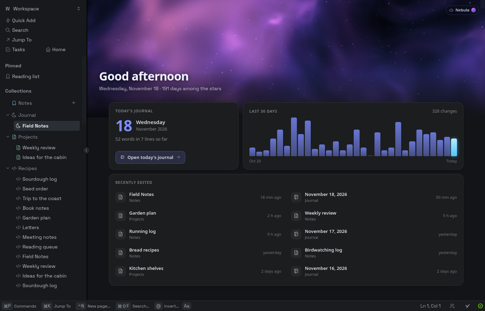
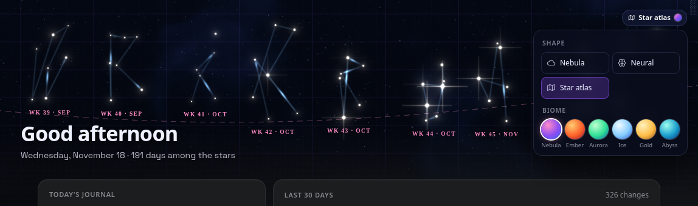
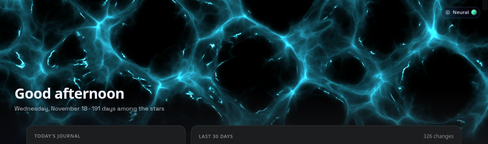

# Home

A dashboard of your own, opened from a Home button beside Tasks in the sidebar. Across the top of the panel is a sky drawn with WebGL (a nebula, a neural field or a star atlas, in one of six colour biomes) with a greeting and today's date; under it, a bar for each of the last 30 days, today's journal and the pages edited last. All of it is read from what changed in the workspace and when.

## Opening it

- A **Home** button sits beside Tasks in the sidebar. It is a copy of Thymer's own Tasks row, so it looks the same; the two share the line, and stack when the sidebar is collapsed to its icons. Nothing of Thymer's is moved.
- `Home: open` from the command palette does the same.

Home opens in the panel you are working in (or a new one), without the panel's title bar, so the sky starts at the top; the bar comes back when the panel shows something else.

## The sky

The header is deep space drawn with WebGL. Its greeting follows the time of day and uses your first name (the first word of your display name, or the part of an email before the @); under it are the date and how many days have had changes. A picker in the sky's top-right corner chooses its **shape**:

- **Nebula** – close in front of a cloud of glowing gas in layers at different depths, with bright ionised hearts and dark dust drifting in front. The camera slides slowly along it, from today's end to the oldest and back, so the near layers pass the far ones. It is the gas alone, without dots for the days.
- **Neural** – a living field of glowing filaments, like a nervous system, across the whole sky (a port of [zozuar's shader](https://twitter.com/zozuar/status/1625182758745128981), on Shadertoy as [mlBXRK](https://www.shadertoy.com/view/mlBXRK)), in the biome's colours. The more days with changes (up to 240), the denser and quicker the field; a few days give a slow field of a few wide filaments. It too has no dots for the days.
- **Star atlas** – a flat chart on deep blue paper, gas drifting behind it, with a fine grid and the dashed ecliptic. Every day on which something changed is a star, bigger and brighter the more changed that day, the brightest with four diffraction spikes. Every week is a constellation labelled with its number and month (`Wk 47 · Nov`); days in a row within a week are joined by soft lines along which pulses of light run from the older day to the newer. Today's star has a ring that breathes, and pointing at a star tells its date and how much changed. The chart pans slowly from today to the oldest week and back.

and its **biome**, the colours any shape is drawn in: Nebula, Ember, Aurora, Ice, Gold or Abyss.

`Home: next sky shape` and `Home: next biome` work from the command palette too. The shape and the biome are kept per device.

## Under the sky

- **Today's journal** – today's date, how many words in how many lines you have written in today's journal page so far (or "Nothing written yet today"), and a button that opens it.
- **Last 30 days** – a bar for each day, as tall as its changes, today's in its own colour, with the total over the 30 days; pointing at a bar tells its date and count.
- **Recently edited** – the ten pages edited last, each with its collection and how long ago; a click opens the page.

The page follows the panel's width, not the window's: in a narrow panel the sky is a little shorter, the greeting smaller and the cards stack.

## How it works

What changed when is read from the workspace when Home opens (and again when it opens after two minutes): a page counts on the day it was made, a line on the day it was written and on the day it was last changed. Lines written while Home is open add to today as they come (today's star in the Star atlas, today's bar). Home is off on phones and tablets. There are no settings.

## Credits

The Neural sky is a port of a shader by zozuar ([tweet](https://twitter.com/zozuar/status/1625182758745128981); on Shadertoy as [mlBXRK](https://www.shadertoy.com/view/mlBXRK), by gena): thirty octaves of turning, warped sine waves whose sum glows where it bunches up into filaments, drawn here in the biome's colours.

## Install

A global plugin: create one (Plugins → New → Global plugin), open **Edit Code**, paste `plugin.js` into the code tab, `plugin.css` into the **CSS** tab and `plugin.json` into the **Configuration** tab, and save.
