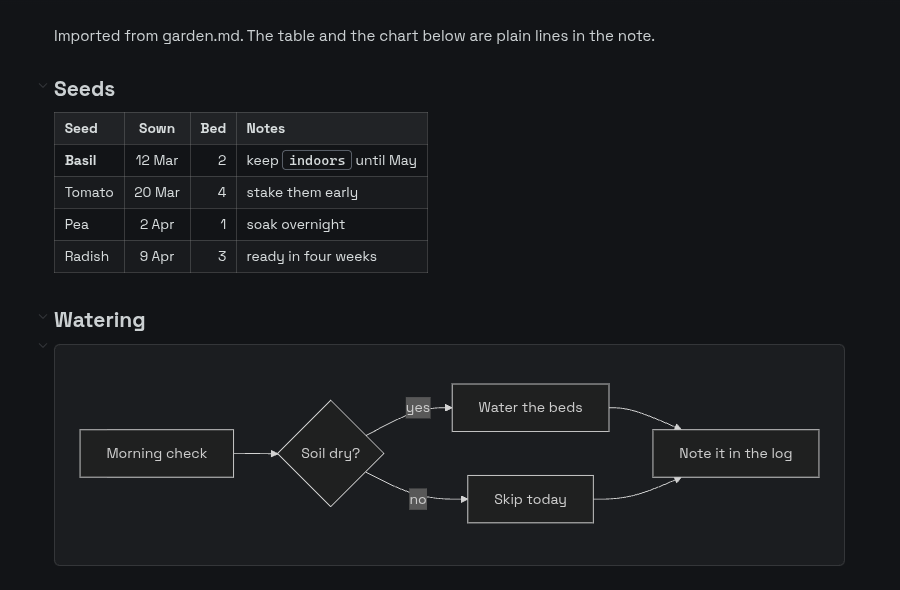

# Markdown Fix

Draws what Thymer's Markdown import leaves as plain text. A GFM pipe table arrives as lines that start with `|`, and a ```` ```mermaid ```` fence arrives as a code block with no language; Thymer's editor has no table block. This plugin shows the table as a table and the code block as its diagram, each with a button to show the source again. The notes themselves are not edited, so search, export and the Markdown they came from stay as they are.



## What it does

- **Tables.** A run of plain text lines made of a header row (`| a | b |`), a separator row (`| --- | :---: |`) and the rows under it becomes a table. Bold and italic are kept, inline code is kept whole, `\|` stays a pipe, and the colons in the separator row set each column's alignment (left, centre, right). Lines inside code blocks are left alone.
- **Diagrams.** A code block whose text starts with a mermaid diagram type (`flowchart`, `graph`, `sequenceDiagram`, `classDiagram`, `stateDiagram`, `erDiagram`, `gantt`, `pie`, `journey`, `mindmap`, `timeline`, `gitGraph`, `quadrantChart`, `requirementDiagram`, `C4Context`, `sankey-beta`, `xychart-beta`, `block-beta`) gets its diagram drawn in place of the code. The diagram uses the editor's font and mermaid's dark or default theme, picked from how dark the page is; it fits the width of the page, down to half its natural size, and scrolls sideways past that. A literal `\n` in a label is a line break, and an edge label holding characters mermaid rejects unquoted (like `#` or brackets) is tried again in quotes. If a diagram cannot be drawn, the code stays and a red line under it says why.
- **The source.** Each table and diagram has a small `</>` button in its top-right corner (it shows on hover) that hides the drawing and shows the lines again, and brings the drawing back. This choice lasts until the plugin reloads.

When the lines change, the drawing follows; when they stop being a table or a diagram, it goes.


There are no commands or settings.

## How it works

The drawings are put inside the line's own element (a table in its first row's line, a diagram in the code block), never between the editor's rows, and the lines they stand for are hidden with CSS, never removed. Every pass over the page is idempotent, so it runs whenever the editor's DOM changes.

Diagrams are drawn by [mermaid](https://mermaid.js.org) 11.4.1, which is loaded from jsDelivr (`cdn.jsdelivr.net`) the first time a diagram is found, so diagrams need a network connection; tables do not.

## Install

A global plugin: create one (Plugins → New → Global plugin), open **Edit Code**, paste `plugin.js` into the code tab, `plugin.css` into the **CSS** tab and `plugin.json` into the **Configuration** tab, and save.
