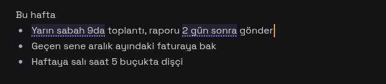

# Smart Dates

Date words typed in a line, in Turkish or English ("yarın sabah", "2 gün önce", "saat 5", "geçen sene aralık", "tomorrow at 3pm", "next monday", "three days after"), become Thymer date tags. While you type in a line, the phrases it found get a dotted violet underline; once the caret has left the line, each phrase is replaced by a date tag.

## What it does

- The underline shows only on the line the caret is in, and nothing in the line changes while you are in it (changing it then would race your typing).
- Once the caret has left the line and Thymer has saved it, each phrase becomes a date tag. A week, a month or a year stays a range; a day with a time gets the time.
- Only lines typed in (or pasted) on this device are changed, never lines written by MCP, imports, other plugins or another device.
- A tag you remove by hand stays text: that phrase is not turned again in that line.
- Text inside code, links, tags, mentions, references and existing date tags is skipped, as are code blocks. Text, task, list, heading and quote lines are changed.

## What it understands

Numbers can be digits or words up to thirty (`iki`, `üç`, `on`, `two`, `three`, `ten`, `a`, `an`). A Turkish phrase may carry its case ending (`yarına`, `pazartesiye`, `gelecek cumadan`, `pazartesi günü`, `sabah 9da`, `saat 5te`), and `ı` also matches `i`, for text typed without Turkish letters.

| | Turkish | English |
| --- | --- | --- |
| Days | `bugün`, `yarın`, `dün`, `öbür gün`, `yarından sonra`, `evvelsi gün`, `ertesi gün` | `today`, `tomorrow`, `yesterday`, `day after tomorrow`, `day before yesterday`, `next day` |
| Weekdays | `pazartesi`, `haftaya salı`, `gelecek cuma`, `geçen pazartesi`, `bu perşembe` | `monday`, `next friday`, `last monday`, `this thursday`, `coming friday` |
| Weeks, months, years | `geçen hafta`, `gelecek ay`, `bu yıl`, `önümüzdeki sene`, `haftaya`, `seneye` | `last week`, `next month`, `this year` |
| Counted | `2 gün önce`, `üç gün sonra`, `2 hafta sonra`, `3 saat sonra`, `10 dakika önce`, `yarım saat sonra` | `3 days ago`, `three days after`, `two weeks later`, `in 3 days`, `2 hours from now`, `half an hour later` |
| Dates | `15 aralık`, `15 aralık 2025`, `aralık 2025`, `geçen aralık`, `geçen sene aralık`, `15.12.2025`, `2025-12-15` | `december 15`, `15th of december`, `dec 15, 2025`, `december 2025`, `last december`, `last year december` |
| Times | `saat 5`, `saat 17:30'da`, `saat 5 buçukta`, `sabah 9'da`, `akşam saat 7`, `gece 11:30`, `17:30`, `öğlen` | `3pm`, `3:30 pm`, `at 5`, `at 17:30`, `17:30`, `noon`, `midnight` |
| Parts of a day | `bu sabah`, `bu öğleden sonra`, `bu akşam`, `bu gece` | `this morning`, `this afternoon`, `this evening`, `tonight` |

A day and a time next to each other are one tag: `yarın sabah`, `yarın saat 5`, `pazartesi akşam`, `tomorrow at 3pm`, `monday evening`, `5pm tomorrow`. A time alone becomes a time tag. A part of the day alone (`akşam`, `evening`) is not a date. A bare hour from 1 to 6 means the afternoon (`saat 5` is 17:00). Some words are only dates with a qualifier, since they are often plain words: a month name alone (`may`, `ekim`), and `pazar` and `cuma` without `günü` or a word like `gelecek`. Dates with dots or slashes are read day first. Counted days are a single day; counted weeks and months are ranges; counted hours and minutes are a time from now.

## Commands

- `Smart Dates: turn on/off` turns the plugin on or off and saves that as `enabled` under `custom` in the plugin's configuration.
- `Smart Dates: turn dates in the current line into tags now` converts the caret's line straight away, including phrases whose tags were removed by hand.

## How it works

The underline is the CSS Custom Highlight API (`::highlight(sd-date)` in `plugin.css`, with a darker variant on light themes); nothing is inserted into the line. The plugin listens to Thymer's line events for lines changed on this device and polls while some are waiting for the caret to leave. Each phrase is turned into the English that Thymer's own date parser reads (`DateTime.parseDateTimeString`), so ranges stay ranges there, and a time is put on the day with `setTime`; the line's text segments are then replaced with date segments.

## Install

A global plugin: create one (Plugins → New → Global plugin), open **Edit Code**, paste `plugin.js` into the code tab, `plugin.css` into the **CSS** tab and `plugin.json` into the **Configuration** tab, and save.
