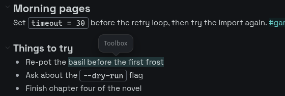

# toolbox

A small box with an arrow that floats above the text you select. It holds nothing yet: it is a place to put tools that act on a selection, and tools are added to a `TOOLS` list in the code. Until then it shows the word "Toolbox".



## What it does

- The box shows as soon as there is a selection, centred over its first line, and goes with it while you scroll or the selection grows.
- When there is no room above the selection (under the panel's title bar), it sits below it, its arrow pointing up.
- It hides when the selection is gone or scrolled out of sight. Escape puts it away until the selection changes.
- Pressing on the box does not take the focus, or the selection, away from the text.

There are no commands or settings.

## Adding a tool

Add an entry to `TOOLS` at the top of `plugin.js`:

```js
const TOOLS = [
  { icon: 'ti-copy', title: 'Copy', run: ({ text }) => { /* do something with text */ } },
];
```

Each entry becomes a button in the box with its icon (a Tabler icon name) and its title as a tooltip. `run` gets `text`, the browser's selected text, which is empty when Thymer's own selection is not mirrored in the browser's.

## How it works

Thymer's editor draws its selection as a layer of its own (rectangles under the text in `.listview-selections`) rather than with the browser's, so the selection is found from those rectangles, and from the browser's selection when that is in a line instead. Nothing reacts to an event: the selection is looked at once a frame, which keeps the box in step with scrolling and with a selection that grows under the mouse or the keyboard.

## Install

A global plugin: create one (Plugins → New → Global plugin), open **Edit Code**, paste `plugin.js` into the code tab, `plugin.css` into the **CSS** tab and `plugin.json` into the **Configuration** tab, and save.
