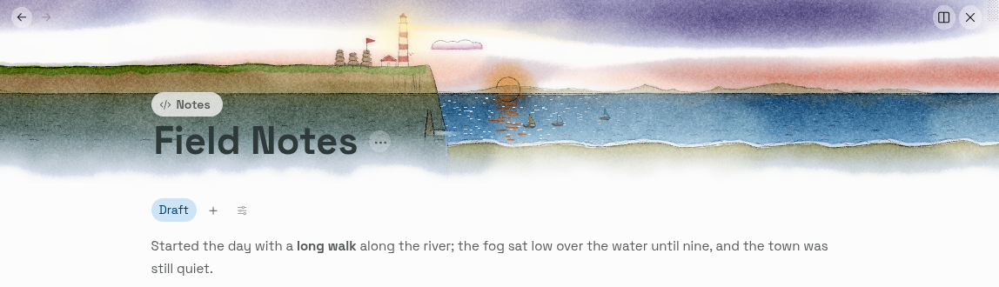
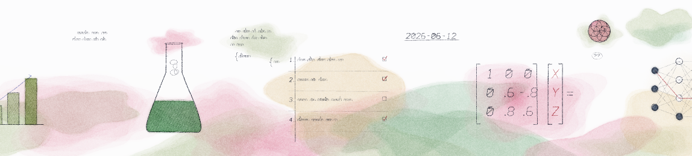
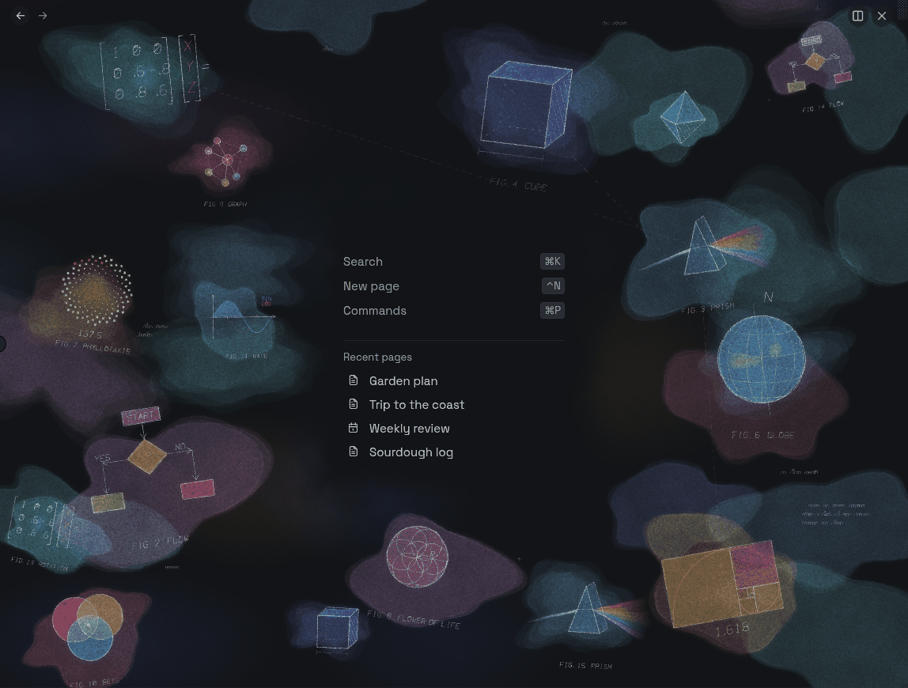

# Watercolor Banner

Two drawings in pencil and watercolour for every page, drawn from the page, after the header and footer of [lucumr.pocoo.org](https://lucumr.pocoo.org). At the top, in place of a missing banner, a landscape; at the bottom, behind the end of the page and edge to edge, a page of an engineer's sketchbook. An empty panel gets a sheet of geometry studies around Thymer's start screen. Nothing is written into the workspace: no image is uploaded, the page is not changed, and turning the plugin off leaves every page as it was.

## The header

One of seven scenes: mountains, a coast, a lighthouse at dusk whose beam turns, a meadow with gusts in the grass, a lake whose reflection wavers, a forest in drifting mist, dunes. Words in the title or the tags pick one (sea, beach, light, idea, garden, lake, journal, forest, desert, mountain, ... in English and Turkish), else the title's seed does; a command picks another.

What the page decides, in every scene:

| From the page | In the picture |
| --- | --- |
| title | the seed: where everything stands |
| #tags | one range (hills, dunes, a row of trees, an island) per tag, the most used in front, in the tag's pigment and the tag's own form; more tags tint the sky |
| collection | the house colour: the sky, and the ranges no tag claims |
| words | the viewing distance: a short note is a close view, a long text a wide one |
| tasks | trees, boats, bushes or cacti, the done ones painted in; how many are done sets the weather (a low warm sun when most are done, cloud when few are) |
| headings | cairns (a flag on the first for a top heading) |
| code | masts with a wire, a pier, a windmill or a lookout |
| quotes | birds |
| lists | a fence, or reeds |
| images | a lake, a pond, an island or a boat |
| created | the season (snow on the heights in winter, autumn trees) and how yellowed the paper is |

The strip takes a banner's height while it shows a picture. A page with a banner of its own keeps it. If Auto Banner is also on, this plugin's picture takes the strip and Auto Banner's stays hidden.

## The footer

At the bottom of every page, behind the end of the content and edge to edge, a page of an engineer's sketchbook after lucumr's footer: big pastel washes, large drawings with their construction lines (gears in mesh with centre lines, a neural network, a flask with hatched liquid, a tree of nodes, a letter on its grid with a dimension, a window sketch, a listing, a numbered checklist, a chart, a coiled snake, a cloud, and the geometry studies), small studies, notes in a quick hand and the date. It is laid out by the title; a command turns to another layout. It lies behind the text and adds no scroll: 300 pixels high, 200 on a phone.

## The start screen

An empty panel gets a sheet of numbered geometry studies around Thymer's start screen: a prism splitting light, a cube, a globe, a rotation matrix, the golden rectangle and its spiral, a flow chart, a graph, sine and cosine, the flower of life, an octahedron, three circles, a sunflower's seeds. They stand around the start screen's cards, are laid out anew every day, and are transparent where nothing is drawn, so the screen's own background shows.

## How it is painted

1. The geometry is drawn with seeded 2D canvases into two layers, a wash (the watercolour) and a pencil. Everything stands at a fixed place, so a wider panel shows more of the same picture instead of a stretched or reshuffled one.
2. A WebGL shader turns the two layers into the medium: the wash's edge wanders and bleeds, pigment collects at its rim, granulates in the paper's tooth and multiplies the paper as pigment does; the pencil catches on the same tooth. The picture paints in when first seen: the pencil sweeps from left to right, then the washes bloom after it. The previous picture first soaks into the paper, in patches.
3. A second, small shader draws only what moves over the finished picture, a dozen frames a second and nothing while the strip is out of sight: the shadows of clouds, the lighthouse's beam turning, glints on the sea, the lake's reflection wavering, gusts in the grass, mist drifting between the trees.

On a dark theme the same picture is drawn with light instead of pigment: the washes are light on the page's colour and the pencil is chalk. The paper is the panel's own colour, read from the theme (colours given in Display-P3, oklch() or lab() are resolved by painting a pixel), and every picture is drawn again when the theme changes. With reduced motion asked for by the system, or motion turned off, pictures appear at once and nothing moves.

## Commands

- `Watercolor Banner: another scene for this page` (kept on this device)
- `Watercolor Banner: back to this page's own scene`
- `Watercolor Banner: another footer sketch for this page` (kept on this device)
- `Watercolor Banner: paint this page again`
- `Watercolor Banner: motion on or off`
- `Watercolor Banner: footer on or off`
- `Watercolor Banner: turn on or off` (on this device)

## Settings

Under `custom` in the Configuration: `"exclude": ["Journal"]` skips collections by name.

## Credits

The technique follows [lucumr.pocoo.org](https://lucumr.pocoo.org): Armin Ronacher's "Ridgeline and strata" header and "Sketchbook margins" footer, written anew for Thymer.

## Install

A global plugin:

1. In Thymer, create a new global plugin (Plugins → New → Global plugin).
2. Open **Edit Code** and paste `plugin.js` into the code tab.
3. Paste `plugin.css` into the **CSS** tab.
4. Paste `plugin.json` into the **Configuration** tab and save.

It reuses the plugin slot BetterSidebar had in Thymer.
