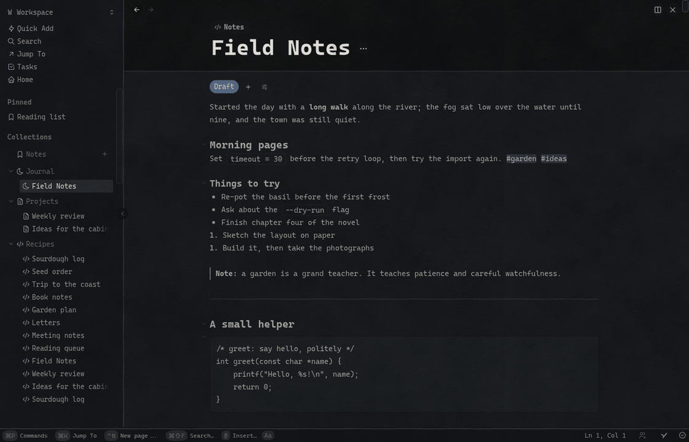
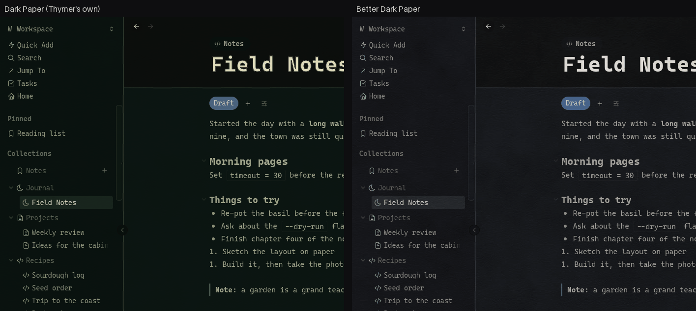
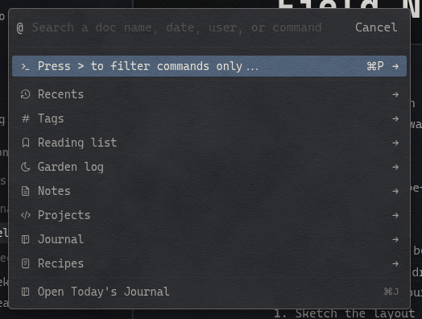

# Better Dark Paper

A theme, not a plugin: Thymer's Dark Paper without its green cast. Dark Paper's own colours sit between 130 and 185 degrees of hue (moss to teal), so the paper, the ink, the accent, the pencil lines and the sidebar icons all lean green. Better Dark Paper keeps everything else about Dark Paper (its fonts, its paper scan, its pencil lines) and turns its colours to a charcoal night: the paper a charcoal grey a little lifted, with only a breath of night blue in it, the ink a soft paper white, the accent a muted fountain-pen blue, the lines graphite.





## What it changes

- Every colour of Dark Paper is turned in OKLCH with its lightness kept: the sheet (`--color-bg-*`) is lifted a little and made charcoal with a trace of night blue; text is paper white with the faintest warmth; the accent (`--color-primary-*`) is a muted ink blue; the pencil lines (`--paper-line*`) are graphite; Dark Paper's green flame becomes an ember. Greys, black and white (shadows, scrims) stay as they are.
- Tag, banner and board colours, whose variables are named after a colour (`-red`, `-blue`, `-amber`, ...), keep their hue.
- The paper scan Dark Paper multiplies over the window is tan, so it is made grey: it darkens evenly and the charcoal stays charcoal.
- The same scan is laid once more in soft-light, grey and centred on middle grey, so the paper's grain shows on the dark sheet without making it lighter or darker overall.
- The chosen row of the command palette is a deeper ink blue, so its cream text stays legible (about 5:1 instead of 2.5:1).
- The edge of the command palette and of dialogs drawn on it (the theme picker, ...) is a still graphite line on the box's own corners, instead of a pencil line shaken by a noise filter that wanders off the box on a dark sheet.
- The page title is plain paper white with a soft shadow for banners, instead of Dark Paper's 1px black stroke that makes bold letters read hollow on a dark sheet.
- Faint text is one step brighter: muted text (row previews, descriptions, hints) from about 2.4:1 to 4.7:1 on the panel, and search placeholders from about 1.7:1 to 3.4:1.
- Settings → Plugins lists global plugins and collections as one raised sheet of compact rows (an icon tile, the name over a one-line description, the switch and a quiet Edit Code button that lights up with its row) with the count at the foot, instead of a grid of cards in the panel's own colour. Off and trashed plugins keep their row and fade.



## Install

The theme is custom CSS. A theme in Thymer is a rule `html[data-theme="<id>"]` in the workspace's custom CSS; its label in the theme picker is the id without its first word, so `thymer-better-dark-paper` shows as "Better Dark Paper".

By hand:

1. Paste `better-dark-paper.css` into the workspace's custom CSS, alongside anything already there.
2. Pick **Better Dark Paper** in Thymer's theme picker (Set Theme).

With `push.py`, through the Thymer desktop app's local MCP server:

```sh
python3 themes/better-dark-paper/push.py [--workspace NAME] [--remove] [--port 13100]
```

- It needs Thymer open, with the workspace's MCP access set to readwrite (command palette → MCP Settings). Without `--workspace` it uses the focused workspace.
- The theme lives between its start and end markers (`/* ===== Better Dark Paper theme start ===== */` ... `theme end`) in the custom CSS: a push replaces that block, or appends it, and leaves the rest of the custom CSS as it is. `--remove` takes the block out.
- The live custom CSS is saved to `.backups/` first, and the CSS is read back to check it was written.
- Then pick "Better Dark Paper" in the theme picker (the MCP server's `set_theme` only knows the built-in themes).

## Building

`better-dark-paper.css` is generated; do not edit it by hand. Edit `build.py` or `extra.css` and build again:

```sh
python3 themes/better-dark-paper/build.py [app.css]
```

A theme in the custom CSS gets none of the built-in themes' rules, so `build.py` copies every rule Thymer writes for Dark Paper (`thymer-dark-paper`, the shared dark rules included) from Thymer's `app.css` to the new id, recolours it as above, and points its assets (`url(./...)`) at Thymer's `/css/` folder. Without an argument it reads `app.css` from the Thymer desktop app's cache (`~/.config/Thymer/...` on Linux, `~/Library/Application Support/Thymer/...` on macOS). `extra.css` (hand-written) goes on top: `build.py` puts the theme's `html[data-theme]` selector in place of `ROOT`, and Dark Paper's paper scan (its file name changes with Thymer's builds) in place of `PATTERN`.
